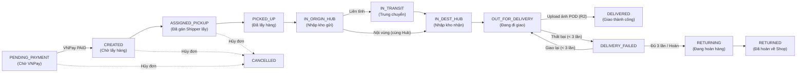

<div align="center">

# UTEExpress — Hệ thống Quản lý Chuỗi Giao nhận Logistic Đa Bưu cục

**Nền tảng điều phối vận chuyển liên tỉnh & nội vùng (Multi-Hub Logistics Chain) theo thời gian thực**

[](https://openjdk.org/projects/jdk/21/)
[](https://spring.io/projects/spring-boot)
[](https://www.postgresql.org/)
[](https://getbootstrap.com/)
[](https://developers.cloudflare.com/r2/)
[](#kiểm-thử-tự-động)

[Tính năng](#tính-năng-theo-phân-hệ) • [Vòng đời vận đơn](#vòng-đời-vận-đơn--kiến-trúc) • [Cài đặt nhanh](#hướng-dẫn-cài-đặt--chạy-local) • [Tài khoản Demo](#dữ-liệu-demo-mặc-định) • [Tài liệu](#tài-liệu-kỹ-thuật-docs) • [Đội ngũ](#đội-ngũ-thực-hiện)

</div>

---

## Tổng quan Dự án

**UTEExpress** là hệ thống web quản lý chuỗi giao nhận vận chuyển đa bưu cục (Multi-Hub Logistics Chain) mô phỏng sát quy trình thực tế của các đơn vị chuyển phát nhanh hiện đại (Giao Hàng Nhanh, Viettel Post).

Hệ thống kết nối xuyên suốt **5 nhóm người dùng** (`Guest`, `Customer`, `Staff`, `Shipper`, `Admin`) trên một kiến trúc **Spring Boot 3 Monolith phân lớp rõ ràng**, hỗ trợ:
- **Định tuyến chuỗi đa bưu cục tự động** (`Origin Hub → Inter-Province Transit → Destination Hub`) với 13 trạng thái được kiểm soát chặt bằng State Machine.
- **Cập nhật hành trình, thông báo & Chat CSKH thời gian thực** qua WebSocket (`STOMP / SockJS`, sự kiện `AFTER_COMMIT`).
- **Thanh toán cước trực tuyến VNPay Sandbox** (xác thực chữ ký `HMAC-SHA512` constant-time, xử lý Return/IPN **idempotent**).
- **Lưu trữ ảnh chứng từ giao hàng (POD) bảo mật trên Cloudflare R2** (Private Bucket, proxy kiểm tra chống IDOR).
- **Xuất tem vận đơn PDF khổ A6/A5 tiếng Việt** tích hợp mã vạch `Code128`, `QR Code` và mã định tuyến Hub.
- **Chu trình quản lý & đối soát tiền thu hộ COD khép kín** từ Shipper → Bưu cục → Admin (tự động cấn trừ cước chưa trả `BR-09`) → Khách hàng.

---

## Vòng đời Vận đơn & Kiến trúc



### Quy tắc Nghiệp vụ & Bảo mật Cốt lõi

| Quy tắc | Mô tả triển khai thực tế |
| :--- | :--- |
| **Tính cước & Trọng lượng quy đổi** | `volumetric = (D × R × C) / 5000`; `chargeable = ceil_0.5kg(max(actual, volumetric, baseWeight))`; tự động cộng phụ phí liên tỉnh & phí thu hộ COD; lưu snapshot cước vào đơn để đổi bảng giá không ảnh hưởng đơn cũ. |
| **Chống IDOR đa tầng** | Customer chỉ xem/hủy/tải PDF/xem POD/chat đơn của chính mình; Staff chỉ thao tác đơn thuộc `origin/dest/current Hub` của mình; Shipper chỉ xử lý đơn được phân công và bị chặn khỏi PDF/Chat (`403`); WebSocket kiểm tra quyền phòng chat ngay tại `WebSocketAuthChannelInterceptor`. |
| **Xác thực JWT Stateless** | Spring Security 6 stateless với `HS256` JWT lưu trong cookie `HttpOnly` (`ACCESS_TOKEN`) + hỗ trợ `Authorization: Bearer`; tách biệt rõ lỗi `401/403 JSON` cho `/api/**` và redirect `/auth/login` hoặc trang `403.html` cho Web MVC; khóa tài khoản (`LOCKED`) vô hiệu hóa token ngay lập tức. |
| **Thanh toán VNPay & Hoàn tiền** | Xác thực `HMAC-SHA512` bằng `MessageDigest.isEqual`; kiểm tra khớp số tiền (`totalFee × 100`); callback `/payment/vnpay-return` & `/api/v1/payment/vnpay-ipn` xử lý **idempotent** (`RspCode=02`); hủy đơn đã `PAID` tự chuyển `REFUND_PENDING`. |
| **Chứng từ POD trên Cloudflare R2** | Bắt buộc upload ảnh `JPG/PNG/WEBP <= 5MB` khi giao thành công; lưu vào bucket **Private** với key `pod/{uuid}.{ext}`; chỉ stream qua endpoint bảo vệ `GET /files/pod/{shipmentId}`. |
| **Đối soát COD cấn trừ cước (`BR-09`)** | `HELD_BY_SHIPPER → COLLECTED_BY_HUB → SETTLED`; công thức phiếu đối soát: `Thực chuyển = Tổng COD − Tổng cước Người gửi trả chưa thanh toán`; tự động cập nhật `paymentStatus = PAID` và bắn thông báo WebSocket khi duyệt. |

---

## Tính năng theo Phân hệ

### 1. Cổng Công khai (`Guest` — Không cần đăng nhập)
- **Trang chủ (`/`):** Giới thiệu dịch vụ, ô tra cứu nhanh mã vận đơn và bảng so sánh các gói cước.
- **Tra cứu đa vận đơn (`/tracking`):** Tra cứu cùng lúc **1–5 mã vận đơn**, tự động **che SĐT/tên nhạy cảm**, ẩn tiền COD/POD và cập nhật timeline **Live WebSocket** không cần F5.
- **Ước tính cước (`/estimate`):** Gọi `POST /api/v1/public/estimate` tính trọng lượng quy đổi & so sánh giá cước mọi gói dịch vụ theo thời gian thực.
- **Mạng lưới Bưu cục (`/hubs`):** Tra cứu chuỗi bưu cục & kho trung chuyển toàn quốc kèm lọc theo tỉnh/thành và loại hình.

### 2. Cổng Khách hàng / Shop (`CUSTOMER`)
- **Tổng quan (`/customer`):** 4 thẻ KPI (tổng đơn, đang giao, giao thành công, COD chờ đối soát) và danh sách đơn gần nhất.
- **Tạo vận đơn 2 cột Sticky (`/customer/shipments/new`):** Chọn nhanh từ sổ địa chỉ, bật cờ *Hàng dễ vỡ*, chọn quy định đồng kiểm, xem bảng tạm tính cước realtime, thanh toán **Tiền mặt** hoặc chuyển thẳng **VNPay Sandbox**.
- **Quản lý vận đơn (`/customer/shipments`):** 8 tab trạng thái kèm badge số lượng, tìm kiếm theo mã/SĐT/tên hàng, lọc ngày, phân trang, hủy đơn hợp lệ, **Thanh toán lại VNPay**, **In tem PDF A6/A5**, xem & phóng to **ảnh POD**, và **Chat CSKH realtime**.
- **Sổ địa chỉ (`/customer/addresses`), Hồ sơ & Ngân hàng COD (`/customer/profile`), Lịch sử đối soát COD (`/customer/cod`).**

### 3. Cổng Điều phối Bưu cục (`STAFF`)
- **Tổng quan Bưu cục (`/staff`):** Thống kê nhanh các đơn chờ lấy, đang nhập kho, chờ xuất tuyến, giao thất bại và tiền COD Shipper đang giữ tại bưu cục mình phụ trách.
- **Điều phối Vận đơn (`/staff/shipments`, `/staff/shipments/{id}`):** 7 tab nghiệp vụ; thanh thao tác tự động chỉ hiển thị đúng bước hợp lệ tiếp theo (phân công Shipper lấy hàng, nhập kho gửi, xuất trung chuyển liên tỉnh, nhập kho nhận, phân công Shipper giao, giao lại `< 3 lần`, hoàn hàng `RETURNING → RETURNED`); xem ảnh POD và trả lời **Chat CSKH**.
- **Thu tiền COD từ Shipper (`/staff/cod`):** Gom nhóm theo từng Shipper trực thuộc bưu cục và xác nhận thu tiền (`HELD_BY_SHIPPER → COLLECTED_BY_HUB`).

### 4. Cổng Giao nhận (`SHIPPER`)
- **Tác vụ Lấy & Giao (`/shipper/tasks`):** 3 tab (`Cần lấy hàng`, `Cần giao hàng`, `Đã xử lý`), hiển thị nổi bật số tiền cần thu người nhận và cảnh báo hàng dễ vỡ.
- **Xác nhận Giao thành công (POD):** Modal chụp/chọn ảnh có xem trước ngay lập tức, upload trực tiếp lên **Cloudflare R2** (`uteexpress-pod`); báo giao thất bại kèm lý do.
- **Tiền COD đang giữ (`/shipper/cod`):** Theo dõi chi tiết tiền mặt cần nộp về bưu cục cuối ca.

### 5. Cổng Quản trị Chuỗi (`ADMIN`)
- **Dashboard Thống kê (`/admin`):** 4 KPI + **3 biểu đồ Chart.js** (`Doanh thu & sản lượng theo ngày`, `Tỷ lệ trạng thái`, `Sản lượng theo Bưu cục`) có lọc khoảng ngày qua `GET /api/v1/admin/dashboard/charts`.
- **Quản trị Danh mục:** CRUD Chuỗi Bưu cục (`/admin/hubs`), Gói dịch vụ & Bảng giá (`/admin/services`), Tài khoản Nhân sự — tạo Staff/Shipper, gán Hub, khóa/mở tài khoản (`/admin/users`).
- **Duyệt Đối soát COD (`/admin/cod-settlements`):** Lập phiếu đối soát tự động cấn trừ cước chưa trả và xác nhận chuyển khoản kèm mã giao dịch ngân hàng (`SETTLED`).

---

## Tech Stack & Cấu trúc Dự án

| Tầng | Công nghệ sử dụng |
| :--- | :--- |
| **Backend** | Java 21 LTS, Spring Boot `3.4.3`, Spring Web MVC, Spring Validation, Maven `3.9+` |
| **Frontend** | Thymeleaf, Thymeleaf Layout Dialect, Bootstrap `5.3.3`, Bootstrap Icons, Chart.js `4.4` |
| **Database** | PostgreSQL `16` (Docker Compose), Spring Data JPA (Hibernate `ddl-auto=validate`), Flyway (`V1`, `V2`) |
| **Security** | Spring Security 6, JJWT `0.12.6` (`HS256`, Cookie `HttpOnly` + Bearer Header), BCrypt |
| **Realtime** | Spring WebSocket (`STOMP` + `SockJS` In-Memory Broker), `@TransactionalEventListener(AFTER_COMMIT)` |
| **Integrations** | VNPay Sandbox API `v2.1.0` (`HMAC-SHA512`), OpenPDF + ZXing (PDF A6/A5), AWS SDK v2 `S3Client` (Cloudflare R2) |
| **Testing** | JUnit 5, Mockito, Spring MockMvc (`21` lớp test — `97/97` tests PASS) |

```text
UTEExpress/
├── docker-compose.yml               # PostgreSQL 16 (port 5432, healthcheck)
├── pom.xml                          # Maven dependencies (Java 21, Spring Boot 3.4.3)
├── .env.example                     # Mẫu biến môi trường (copy sang .env)
├── docs/                            # Bộ 9 tài liệu thiết kế & kiểm thử chuẩn
└── src/
    ├── main/
    │   ├── java/com/uteexpress/     # 114 tệp nguồn Java
    │   │   ├── config/              # Security, WebSocket + ChannelInterceptor, R2, VNPay
    │   │   ├── controller/
    │   │   │   ├── web/             # Public, Auth, Customer, Staff, Shipper, Admin, Payment, Waybill, File, Cod
    │   │   │   ├── api/             # Auth, Pricing, Tracking, Notification, Chat, Dashboard, VNPay IPN
    │   │   │   └── ws/              # ChatWebSocketController (@MessageMapping)
    │   │   ├── dto/                 # Request/Response records & DTOs theo phân hệ
    │   │   ├── entity/              # 9 JPA Entities khớp 100% Flyway schema
    │   │   ├── enums/               # 10 Enums trạng thái, vai trò, thanh toán, COD
    │   │   ├── exception/           # WebExceptionHandler & ApiExceptionHandler tách biệt
    │   │   ├── repository/          # 9 Spring Data JPA Repositories + Specifications
    │   │   ├── security/            # JwtTokenProvider, JwtAuthenticationFilter, CustomUserDetails
    │   │   └── service/             # Pricing, StateMachine, Shipment, VNPay, WaybillPDF, R2, Chat, COD, Dashboard
    │   └── resources/
    │       ├── application.yml      # Nạp tự động optional:file:.env[.properties]
    │       ├── db/migration/        # V1__init_schema.sql (9 bảng, 12 index) & V2__seed_data.sql
    │       ├── fonts/               # DejaVuSans & DejaVuSans-Bold (PDF tiếng Việt)
    │       ├── static/              # css/app.css + 4 module JS (order-form, tracking-ws, notifications-ws, chat-ws)
    │       └── templates/           # 30 giao diện Thymeleaf (layout, public, auth, customer, staff, shipper, admin, error)
    └── test/java/com/uteexpress/    # 21 lớp Unit, Integration & E2E Tests (97 tests)
```

---

## Hướng dẫn Cài đặt & Chạy Local

### 1. Yêu cầu môi trường
- **JDK 21+** (`java -version`)
- **Maven 3.9+** (`mvn -version`)
- **Docker & Docker Compose** (`docker compose version`)

### 2. Cấu hình biến môi trường (`.env`)
Sao chép file mẫu `.env.example` thành `.env`:

```bash
cp .env.example .env
```

Điền các nhóm thông số trong `.env` *(file `.env` đã nằm trong `.gitignore`, tuyệt đối không commit lên Git)*:

| Nhóm cấu hình | Biến môi trường | Ghi chú |
| :--- | :--- | :--- |
| **Ứng dụng** | `APP_PORT`, `APP_BASE_URL` | Mặc định `8080` / `http://localhost:8080` |
| **PostgreSQL** | `POSTGRES_HOST`, `POSTGRES_PORT`, `POSTGRES_DB`, `POSTGRES_USER`, `POSTGRES_PASSWORD` | Mặc định khớp sẵn `docker-compose.yml` (`uteexpress` / `uteexpress123`) |
| **JWT** | `JWT_SECRET`, `JWT_EXPIRATION_MS` | Chuỗi bí mật HS256 tối thiểu 32 ký tự; mặc định hạn 24 giờ (`86400000`) |
| **VNPay Sandbox** | `VNPAY_TMN_CODE`, `VNPAY_HASH_SECRET`, `VNPAY_PAY_URL`, `VNPAY_RETURN_URL` | Đăng ký miễn phí tại [sandbox.vnpayment.vn/devreg](https://sandbox.vnpayment.vn/devreg/) |
| **Cloudflare R2** | `R2_ENDPOINT`, `R2_ACCESS_KEY_ID`, `R2_SECRET_ACCESS_KEY`, `R2_BUCKET_NAME` | Tạo bucket Private (VD: `uteexpress-pod`) và API Token quyền *Object Read & Write* |

### 3. Khởi động PostgreSQL 16 bằng Docker
```bash
docker compose up -d
docker compose ps   # Đảm bảo uteexpress-postgres ở trạng thái healthy
```

### 4. Chạy ứng dụng Spring Boot
```bash
mvn spring-boot:run
```
Hoặc đóng gói và chạy từ file JAR:
```bash
mvn clean package
java -jar target/uteexpress-0.0.1-SNAPSHOT.jar
```
*(Nếu cổng `8080` đang bận, bạn có thể đổi đồng bộ `APP_PORT`, `APP_BASE_URL`, `VNPAY_RETURN_URL` trong `.env` sang cổng khác như `8085`.)*

Truy cập hệ thống tại: **`http://localhost:8080`**

---

## Dữ liệu Demo mặc định

Flyway tự động khởi tạo schema (`V1`) và nạp sẵn dữ liệu mẫu phong phú (`V2__seed_data.sql`) gồm **6 bưu cục**, **3 gói cước**, **6 tài khoản**, **5 vận đơn trải đủ các chặng**, nhật ký hành trình, thông báo và tin nhắn CSKH mẫu.

### Tài khoản mẫu *(Mật khẩu chung: `123456`)*

| Vai trò | Email đăng nhập | Phạm vi / Ghi chú |
| :--- | :--- | :--- |
| **Admin** | `admin@uteexpress.vn` | Toàn quyền quản trị chuỗi, Dashboard & duyệt COD |
| **Staff TP.HCM** | `staff.hcm@uteexpress.vn` | Bưu cục Thủ Đức (`HCM-TD01`) |
| **Staff Hà Nội** | `staff.hn@uteexpress.vn` | Bưu cục Cầu Giấy (`HN-CG01`) |
| **Shipper TP.HCM** | `shipper.hcm@uteexpress.vn` | Bưu cục Thủ Đức (`HCM-TD01`) — có sẵn đơn đang giao |
| **Shipper Hà Nội** | `shipper.hn@uteexpress.vn` | Bưu cục Cầu Giấy (`HN-CG01`) |
| **Customer (Shop)** | `shop@uteexpress.vn` | Shop Hoàng Nam Tech (có sẵn sổ địa chỉ & TK Vietcombank) |

### Mã vận đơn mẫu tra cứu nhanh trên `/tracking`
- `UTE261120A8K4P2` — `CREATED` (Liên tỉnh HCM → HN, đã thanh toán VNPay, có sẵn lịch sử Chat CSKH)
- `UTE261119B7M2Q9` — `IN_TRANSIT` (Đang trung chuyển liên tỉnh `HCM-TD01 → HN-CG01`)
- `UTE261119C3N5X1` — `OUT_FOR_DELIVERY` (Nội vùng Thủ Đức — sẵn sàng để Shipper upload ảnh POD)
- `UTE261118D9P4W7` — `DELIVERED` (`HELD_BY_SHIPPER` — sẵn sàng để Staff HN thu COD)
- `UTE261117E5R8K3` — `DELIVERED` (`COLLECTED_BY_HUB` — sẵn sàng để Admin lập phiếu đối soát COD cấn trừ cước)

### Thẻ test thanh toán VNPay Sandbox
- **Ngân hàng:** `NCB`
- **Số thẻ:** `9704198526191432198`
- **Tên chủ thẻ:** `NGUYEN VAN A`
- **Ngày phát hành:** `07/15`
- **Mã OTP:** `123456`

---

## Kiểm thử Tự động

Chạy toàn bộ bộ kiểm thử (Unit Test + Security Matrix + Anti-IDOR + E2E Liên tỉnh/Nội vùng + VNPay + PDF + R2 + WebSocket + COD):

```bash
mvn test
```

| Nhóm kiểm thử | Lớp kiểm thử tiêu biểu | Kết quả |
| :--- | :--- | :---: |
| **Unit Logic Cốt lõi** | `PricingServiceTest`, `ShipmentStateTransitionTest`, `JwtTokenProviderTest`, `VnPayServiceTest`, `WaybillPdfServiceTest`, `R2StorageServiceTest`, `CodSettlementServiceTest`, `ChatServiceTest`, `DashboardServiceTest` | **PASS** |
| **Web Smoke & E2E Vòng đời** | `Phase1WebSmokeTest`, `Phase2InterProvinceE2ETest`, `Phase3AuditIntegrationTest` | **PASS** |
| **Bảo mật, IDOR & Edge Cases (`08-TEST-PLAN`)** | `AuthSecurityIntegrationTest`, `Phase4AuthAndIdorMatrixTest`, `Phase4PricingVnPayAndCancelTest`, `Phase4LifecycleAndPodValidationTest`, `Phase4WsAuthTrackingAndCodTest` | **PASS** |
| **Tổng cộng** | **21 lớp kiểm thử / 97 test cases** (`0` Failures, `0` Errors) | **97/97 PASS** |

---

## Tài liệu Kỹ thuật (`docs/`)

1. [01-BRD.md](docs/01-BRD.md) — Yêu cầu Nghiệp vụ & Quy tắc nghiệp vụ cốt lõi (`BR-01` → `BR-10`)
2. [02-PRD.md](docs/02-PRD.md) — Yêu cầu Sản phẩm, Personas & User Stories
3. [03-SRS.md](docs/03-SRS.md) — Đặc tả Phần mềm, State Machine & Sequence Diagrams
4. [04-ARCHITECTURE.md](docs/04-ARCHITECTURE.md) — Kiến trúc Hệ thống & Cấu trúc Source Code
5. [05-DATABASE-DESIGN.md](docs/05-DATABASE-DESIGN.md) — Sơ đồ ERD, 9 bảng PostgreSQL & Flyway Seed Data
6. [06-API-AND-ROUTES.md](docs/06-API-AND-ROUTES.md) — Web MVC Routes, REST API & WebSocket Contract
7. [07-UI-UX-SPEC.md](docs/07-UI-UX-SPEC.md) — Design System Bootstrap 5 & Bố cục các màn hình
8. [08-TEST-PLAN.md](docs/08-TEST-PLAN.md) — Ma trận Phân quyền, Test Cases (`TC-AUTH` → `TC-COD`) & Checklist Demo
9. [09-ROADMAP.md](docs/09-ROADMAP.md) — Lộ trình 4 Phase & Phân công 4 thành viên

---

## Đội ngũ Thực hiện

| Thành viên | GitHub | Vai trò & Phân hệ phụ trách |
| :--- | :--- | :--- |
| **Nguyễn Nguyên** | [@NguyenNguyen0210](https://github.com/NguyenNguyen0210) | **Nhóm trưởng** — Khung dự án, Docker/Flyway, JWT Security & Anti-IDOR, Admin CRUD, Dashboard Chart.js |
| **Lê Đàm Nguyên** | [@ledamnguyen01](https://github.com/ledamnguyen01) | Pricing Engine, Customer Portal (Tạo đơn 2 cột, Sổ địa chỉ, Hồ sơ COD), VNPay Sandbox & Xuất Tem PDF A6/A5 |
| **Mạnh Tiến** | [@MTien1105](https://github.com/MTien1105) | Shipment State Machine, Staff Hub Coordination, Shipper Portal & Cloudflare R2 (Ảnh POD) |
| **Thế Quân** | [@qp-isdabest](https://github.com/qp-isdabest) | Public Portal (Tra cứu đa mã, Ước tính, Mạng lưới Hub), WebSocket Realtime (Tracking, Notify, Chat CSKH) & Đối soát COD |

---

<div align="center">
<sub>Đồ án môn Lập trình Web — <strong>UTEExpress Logistics Chain</strong> • Xây dựng với Spring Boot 3 & Java 21</sub>
</div>
