# Tài liệu Yêu cầu Nghiệp vụ (BRD)
## Dự án: Hệ thống Quản lý Chuỗi Giao nhận Logistic — UTEExpress

---

## 1. Tổng quan Dự án & Bối cảnh Bài toán

### 1.1. Bối cảnh
Cùng với sự tăng trưởng mạnh của thương mại điện tử và bán lẻ đa kênh, nhu cầu vận chuyển hàng hóa thông qua mạng lưới nhiều bưu cục/kho trung chuyển ngày càng cao. Tuy nhiên, tại nhiều đơn vị vận chuyển quy mô vừa và nhỏ, quy trình quản lý vẫn phân mảnh:
* Tiếp nhận đơn hàng và điều phối shipper thực hiện thủ công qua tin nhắn/bảng tính, dễ thất lạc đơn hoặc bỏ sót lịch lấy hàng.
* Khách hàng không nắm được vị trí và trạng thái thực tế của bưu kiện qua từng điểm trung chuyển, dẫn đến lượng lớn cuộc gọi hỏi thăm CSKH.
* Thiếu bằng chứng giao nhận rõ ràng (ảnh xác nhận giao hàng) nên khó xử lý khiếu nại giữa người gửi, người nhận và shipper.
* Khâu quản lý tiền thu hộ (COD) giữa Shipper → Bưu cục → Khách hàng phức tạp, dễ lệch số liệu và chậm đối soát.

### 1.2. Tầm nhìn Sản phẩm
**UTEExpress** là nền tảng web tập trung quản lý **chuỗi giao nhận logistic đa bưu cục (Multi-Hub Logistics Chain)**, số hóa khép kín toàn bộ vòng đời vận đơn từ lúc khách hàng tạo đơn, thanh toán cước trực tuyến, in phiếu vận đơn mã QR/Barcode, luân chuyển qua chuỗi bưu cục gửi – trung chuyển – bưu cục nhận, giao hàng kèm ảnh chứng từ (POD), theo dõi hành trình thời gian thực (Realtime Tracking) đến đối soát tiền thu hộ COD và báo cáo điều hành.

---

## 2. Mục tiêu Kinh doanh & Chỉ số Đo lường (KPIs)

| Mã mục tiêu | Mục tiêu nghiệp vụ | Chỉ số đo lường (KPI / Kỳ vọng hệ thống) |
| :--- | :--- | :--- |
| **BO-01** | Chuẩn hóa quy trình luân chuyển vận đơn qua chuỗi đa bưu cục | 100% vận đơn được ghi vết đầy đủ lịch sử chặng (timestamp, bưu cục, người thao tác). |
| **BO-02** | Minh bạch hóa hành trình đơn hàng theo thời gian thực | Khách hàng & người nhận thấy thay đổi trạng thái trong vòng `< 2 giây` qua WebSocket mà không cần tải lại trang. |
| **BO-03** | Số hóa thanh toán & chứng từ giao nhận | Hỗ trợ thanh toán cước online (VNPay Sandbox), xuất phiếu vận đơn PDF có QR/Barcode và lưu ảnh chứng từ POD cho 100% đơn giao thành công. |
| **BO-04** | Minh bạch dòng tiền thu hộ (COD) | Tự động tổng hợp công nợ COD theo từng Shipper, từng Bưu cục và từng phiên đối soát cho Khách hàng, sai lệch = `0`. |
| **BO-05** | Nâng cao trải nghiệm hỗ trợ khách hàng | Tích hợp kênh chat hỗ trợ trực tuyến gắn theo mã vận đơn giữa Khách hàng và Nhân viên bưu cục. |

---

## 3. Các bên Liên quan (Stakeholders)

| Nhóm Stakeholder | Vai trò trong chuỗi giao nhận | Nhu cầu cốt lõi |
| :--- | :--- | :--- |
| **Khách vãng lai (Guest / Người nhận hàng)** | Tra cứu vận đơn được gửi tới mình, tham khảo giá cước và mạng lưới bưu cục. | Tra cứu nhanh bằng mã vận đơn không cần đăng nhập; ước tính chi phí minh bạch. |
| **Khách hàng / Chủ shop (Customer)** | Người tạo đơn và gửi hàng thường xuyên qua UTEExpress. | Tạo đơn nhanh, chọn gói dịch vụ, thanh toán cước online, in phiếu dán lên kiện hàng, theo dõi trạng thái realtime, quản lý đối soát tiền COD. |
| **Nhân viên Bưu cục (Hub Staff)** | Quản lý vận hành tại một bưu cục/kho cụ thể trong chuỗi. | Tiếp nhận đơn, phân công shipper lấy/giao, xác nhận nhập kho/xuất kho trung chuyển liên bưu cục, thu hồi tiền COD từ shipper, phản hồi chat khách hàng. |
| **Nhân viên Giao nhận (Shipper)** | Thực hiện lấy hàng tận nơi và giao hàng chặng cuối (Last-mile) trực thuộc một bưu cục. | Xem danh sách đơn được phân công, cập nhật trạng thái nhanh, tải ảnh bằng chứng giao hàng (POD), kiểm soát tổng tiền COD đang giữ. |
| **Quản trị Hệ thống (Admin)** | Điều hành toàn bộ chuỗi bưu cục UTEExpress. | Quản lý mạng lưới bưu cục/kho (Hub), cấu hình bảng giá gói dịch vụ, quản lý nhân sự, duyệt đối soát COD, theo dõi báo cáo doanh thu & sản lượng toàn chuỗi. |

---

## 4. Phạm vi Dự án (Project Scope)

### 4.1. Trong phạm vi (In-Scope)
1. **Quản lý định danh & phân quyền (Auth & RBAC):** Đăng ký, đăng nhập, phân quyền 4 vai trò (`CUSTOMER`, `STAFF`, `SHIPPER`, `ADMIN`) sử dụng Spring Security + JWT.
2. **Quản lý mạng lưới Chuỗi bưu cục (Hub Network):** Khai báo, cập nhật bưu cục/kho trung chuyển theo tỉnh/thành, phân loại bưu cục địa phương (`POST_OFFICE`) và kho trung chuyển vùng (`SORTING_HUB`).
3. **Quản lý Gói dịch vụ & Tính cước tự động:** Cấu hình gói dịch vụ (*Tiêu chuẩn*, *Nhanh*, *Hỏa tốc*), tự động tính cước theo trọng lượng thực hoặc trọng lượng quy đổi kích thước (`D × R × C / 5000`), tuyến nội vùng/liên tỉnh và phí COD.
4. **Quản lý Vận đơn & Luân chuyển Chuỗi (Shipment Lifecycle):**
   * Tạo đơn kèm tùy chọn đồng kiểm (chuẩn GHN/Viettel Post), đánh dấu hàng dễ vỡ, quản lý sổ địa chỉ và hồ sơ tài khoản ngân hàng nhận COD, hủy đơn hợp lệ.
   * Phân công shipper lấy hàng, nhập bưu cục gửi, điều chuyển trung chuyển liên bưu cục, nhập bưu cục nhận, phân công shipper giao hàng, xử lý giao thất bại & hoàn hàng.
5. **Xuất phiếu vận đơn PDF (QR & Barcode):** Sinh file PDF khổ nhãn vận đơn chuẩn A6 (`105 × 148 mm`, hỗ trợ thêm A5) chứa mã vận đơn dạng Barcode 1D, mã QR dẫn thẳng tới trang tra cứu, mã định tuyến bưu cục (Routing Code), số tiền thu người nhận và lưu ý đồng kiểm.
6. **Thanh toán trực tuyến (VNPay Sandbox):** Cho phép khách hàng thanh toán cước phí vận chuyển trực tuyến qua cổng VNPay Sandbox (xử lý cả Return URL và IPN webhook/cập nhật trạng thái thanh toán an toàn).
7. **Bằng chứng giao hàng (POD — Proof of Delivery):** Cho phép Shipper chụp/upload ảnh xác nhận khi chuyển trạng thái giao thành công (lưu trên Object Storage **Cloudflare R2**, hiển thị cho Khách hàng, Staff và Admin đối chiếu).
8. **Theo dõi hành trình & Thông báo Thời gian thực (WebSocket):**
   * Live tracking trên trang công khai (hỗ trợ tra cứu 1 hoặc nhiều mã vận đơn cùng lúc, tối đa 5 mã/lần) và cổng khách hàng.
   * Thông báo đẩy realtime theo từng vai trò khi có sự kiện vận đơn.
   * Chat hỗ trợ realtime giữa Khách hàng và Nhân viên bưu cục gắn theo mã vận đơn.
9. **Quản lý & Đối soát COD:** Theo dõi Shipper thu hộ → nộp về bưu cục → tạo và duyệt phiên đối soát thanh toán tiền COD cho Khách hàng (có cấn trừ cước phí chưa thanh toán và ghi nhận tài khoản ngân hàng nhận tiền).
10. **Báo cáo & Dashboard thống kê:** Doanh thu cước, tổng sản lượng đơn, tỷ lệ giao thành công/hoàn hàng, biểu đồ theo thời gian và theo từng bưu cục.

### 4.2. Ngoài phạm vi (Out-of-Scope)
* Ứng dụng di động native (iOS/Android) — giao diện Shipper được tối ưu responsive (mobile-first) chạy trực tiếp trên trình duyệt.
* Theo dõi tọa độ GPS trực tiếp của xe tải/shipper theo từng giây trên bản đồ.
* Tích hợp phần cứng máy in nhiệt vật lý qua Bluetooth/USB (hệ thống xuất file PDF chuẩn in ấn để người dùng in từ trình duyệt).
* Kết nối API đối tác thứ ba khác ngoài VNPay Sandbox (không tích hợp hóa đơn điện tử thuế, SMS OTP trả phí hay chuyển khoản ngân hàng tự động thật).
* Quản lý đội xe tải, nhiên liệu, bảo dưỡng phương tiện và tính lương/hoa hồng nhân sự.

---

## 5. Mô hình Vận hành Chuỗi Giao nhận (Operating Model)

```mermaid
flowchart LR
    A["Khách hàng tạo đơn & chọn dịch vụ"] --> B{"Thanh toán cước"}
    B -- "VNPay Sandbox" --> C["Xác nhận thanh toán Online"]
    B -- "Tiền mặt / Người nhận trả" --> D["Chờ lấy hàng (CREATED)"]
    C --> D
    D --> E["Bưu cục gửi phân công Shipper lấy"]
    E --> F["Shipper lấy hàng & nhập Bưu cục gửi"]
    F --> G{"Cùng bưu cục?"}
    G -- "Khác tỉnh / Khác vùng" --> H["Trung chuyển liên bưu cục (IN_TRANSIT)"]
    H --> I["Nhập Bưu cục nhận (IN_DEST_HUB)"]
    G -- "Nội vùng" --> I
    I --> J["Bưu cục nhận phân công Shipper giao"]
    J --> K{"Kết quả giao hàng"}
    K -- "Thành công + Ảnh POD + Thu COD" --> L["DELIVERED → Nộp & Đối soát COD"]
    K -- "Thất bại (< 3 lần)" --> I
    K -- "Thất bại (>= 3 lần)" --> M["Hoàn hàng về người gửi (RETURNED)"]
```

---

## 6. Quy tắc Nghiệp vụ Cốt lõi (Business Rules)

| Mã | Tên quy tắc | Mô tả chi tiết |
| :--- | :--- | :--- |
| **BR-01** | **Quy chuẩn mã vận đơn** | Mỗi vận đơn có mã duy nhất định dạng `UTE` + `YYMMDD` + `6 ký tự chữ số/chữ in hoa ngẫu nhiên` (VD: `UTE261120A8K4P2`), dùng để tra cứu, tạo Barcode và QR code. |
| **BR-02** | **Định tuyến bưu cục gửi & nhận** | Khi tạo đơn, hệ thống tự động (hoặc cho phép) gán **Bưu cục gửi (`origin_hub`)** theo tỉnh/khu vực người gửi và **Bưu cục nhận (`dest_hub`)** theo tỉnh/khu vực người nhận. Nếu `origin_hub == dest_hub` thì xem là đơn **Nội vùng** (bỏ qua bước trung chuyển liên kho); ngược lại là đơn **Liên tỉnh/Liên vùng** (bắt buộc qua trạng thái `IN_TRANSIT`). |
| **BR-03** | **Công thức tính cước & Trọng lượng quy đổi** | Nếu khách nhập kích thước 3 chiều (`Dài × Rộng × Cao`, đơn vị `cm`), trọng lượng quy đổi = `(D × R × C) / 5000` (kg). `Trọng lượng tính cước = max(Trọng lượng thực, Trọng lượng quy đổi)`, làm tròn lên theo bước `0.5 kg`. `Tổng cước = Cước cơ bản (theo gói dịch vụ) + (Trọng lượng vượt ngưỡng × Đơn giá mỗi 0.5kg tăng thêm) + Phụ phí liên vùng (nếu khác tỉnh) + Phí thu hộ COD (% trên tiền COD nếu COD > 0)`. |
| **BR-04** | **Quy tắc người trả cước & Thanh toán** | Khách chọn 1 trong 2 hình thức trả cước: **Người gửi trả (`SENDER`)** hoặc **Người nhận trả (`RECEIVER`)**. Nếu Người gửi trả bằng **VNPay Sandbox**, đơn chỉ chuyển sang trạng thái sẵn sàng điều phối (`CREATED`) sau khi thanh toán thành công (trước đó ở trạng thái `PENDING_PAYMENT`); nếu quá `30 phút` chưa thanh toán thì khách có thể thanh toán lại hoặc hủy đơn. |
| **BR-05** | **Quy tắc hủy vận đơn** | Khách hàng hoặc Staff chỉ được hủy đơn (`CANCELLED`) khi đơn đang ở trạng thái `PENDING_PAYMENT`, `CREATED` hoặc `ASSIGNED_PICKUP` (chưa lấy hàng khỏi tay người gửi). Khi shipper đã lấy hàng (`PICKED_UP` trở đi), không được hủy mà phải chuyển luồng hoàn hàng (`RETURNED`). Nếu đơn đã thanh toán VNPay bị hủy hợp lệ, hệ thống đánh dấu trạng thái `REFUND_PENDING` để Admin/Staff xử lý hoàn tiền. |
| **BR-06** | **Tuân thủ máy trạng thái vận đơn** | Mọi thay đổi trạng thái vận đơn phải tuân theo danh sách chuyển đổi hợp lệ (không nhảy cóc từ `CREATED` sang `DELIVERED`) và bắt buộc sinh 1 bản ghi nhật ký hành trình (`shipment_tracking_logs`). |
| **BR-07** | **Bằng chứng giao hàng (POD)** | Khi Shipper xác nhận giao hàng thành công (`DELIVERED`), **bắt buộc** đính kèm tối thiểu 1 ảnh chụp chứng từ giao hàng hợp lệ (định dạng `JPG/PNG/WEBP`, dung lượng tối đa `5MB`). |
| **BR-08** | **Quy tắc giao thất bại & Hoàn hàng** | Khi giao không thành công (khách không nghe máy, sai địa chỉ, từ chối nhận...), Shipper bắt buộc ghi rõ lý do (`DELIVERY_FAILED`) và hàng quay lại bưu cục nhận. Mỗi đơn được phép giao lại tối đa **3 lần** (`failed_delivery_count`). Nếu thất bại lần thứ 3 (hoặc khách từ chối nhận dứt khoát), Staff kích hoạt quy trình hoàn hàng (`RETURNING` → `RETURNED`). |
| **BR-09** | **Quy trình dòng tiền & Cấn trừ COD** | Với đơn giao thành công có `COD > 0` (hoặc người nhận trả cước): Shipper giữ tiền → nộp về Staff tại bưu cục nhận (`COLLECTED_BY_HUB`) → Admin/Staff tạo **Phiếu đối soát COD (`cod_settlements`)** gom các đơn đã hoàn tất cho Khách hàng. Theo chuẩn GHN/Viettel Post, `Tiền thực chuyển cho Khách = Tổng COD thu được - Tổng cước phí chưa thanh toán (nếu Người gửi trả nhưng chưa thanh toán online)`. Tài khoản ngân hàng nhận tiền lấy từ hồ sơ ngân hàng của Khách hàng. |
| **BR-10** | **Phạm vi dữ liệu theo Bưu cục** | Nhân viên bưu cục (`STAFF`) và Giao nhận (`SHIPPER`) thuộc bưu cục nào chỉ được xem và thao tác các vận đơn liên quan đến bưu cục đó (`origin_hub`, `dest_hub`, hoặc `current_hub`). Riêng `ADMIN` có toàn quyền trên toàn chuỗi. |
| **BR-11** | **Phân quyền xem & chat vận đơn** | Khách hàng chỉ xem chi tiết đầy đủ (số điện thoại, tiền COD, ảnh POD, hóa đơn) và mở phiên chat hỗ trợ đối với vận đơn do chính mình tạo. Trang tra cứu công khai (`Public Tracking`) phải **ẩn/che một phần thông tin nhạy cảm** (tên/SĐT/địa chỉ chi tiết người gửi & nhận). |
| **BR-12** | **Định chuẩn tiền tệ & thời gian** | Toàn bộ số tiền tính bằng `VNĐ` (số nguyên / `DECIMAL(15,0)` hoặc `DECIMAL(15,2)` không sai số dấu phẩy động). Toàn bộ mốc thời gian lưu theo múi giờ chuẩn hệ thống (`Asia/Ho_Chi_Minh` / UTC+7). |
| **BR-13** | **Quy định đồng kiểm & Hàng đặc thù** | Theo chuẩn GHN & Viettel Post, khi tạo đơn người gửi chọn 1 trong 3 chính sách kiểm hàng: `ALLOW_VIEW_NO_TRY` (*Cho xem hàng, không cho thử* — mặc định), `ALLOW_TRY` (*Cho thử hàng*), hoặc `NO_VIEW` (*Không cho xem hàng*); đồng thời có thể đánh dấu cờ **Hàng dễ vỡ (`is_fragile`)**. Các chỉ dẫn này được in nổi bật trên tem vận đơn PDF và hiển thị rõ trên giao diện Shipper. |
| **BR-14** | **Tra cứu đa vận đơn (Public)** | Trang tra cứu công khai hỗ trợ nhập 1 hoặc nhiều mã vận đơn cách nhau bằng dấu phẩy (tối đa **5 mã/lần tra cứu**, tham khảo Viettel Post) để xem nhanh trạng thái tổng hợp và mở chi tiết timeline realtime của từng đơn. |

---

## 7. Giả định, Ràng buộc & Rủi ro

### 7.1. Ràng buộc kỹ thuật & môi trường
* **Công nghệ bắt buộc:** Java 21, Spring Boot 3.x, Maven, Thymeleaf, Bootstrap 5, Spring Data JPA, PostgreSQL 16 (chạy qua Docker Compose), Spring Security + JWT, WebSocket (STOMP/SockJS).
* **Tài nguyên lưu trữ:** Ảnh POD được lưu trên Object Storage **Cloudflare R2** (tương thích chuẩn S3 API, cấu hình key/bucket qua biến môi trường `.env`, có giới hạn dung lượng `<= 5MB` và kiểm tra MIME type).
* **Cổng thanh toán:** Sử dụng môi trường **VNPay Sandbox** (cần cấu hình `TMN_CODE`, `HASH_SECRET`, `RETURN_URL` qua biến môi trường `.env`, không hardcode trong source code).

### 7.2. Giả định nghiệp vụ
* Mỗi tài khoản `STAFF` và `SHIPPER` tại một thời điểm chỉ trực thuộc duy nhất một bưu cục (`hub_id`).
* Danh mục chuỗi bưu cục và bảng giá gói dịch vụ ban đầu được khởi tạo sẵn (seed data) bao phủ các thành phố lớn (VD: TP.HCM — Thủ Đức, Quận 1, Bình Dương, Đồng Nai, Đà Nẵng, Hà Nội) để phục vụ demo luồng nội vùng và liên tỉnh.

### 7.3. Rủi ro chính & Hướng giảm thiểu
| Rủi ro | Tác động | Biện pháp giảm thiểu |
| :--- | :--- | :--- |
| VNPay IPN không gọi được tới `localhost` khi demo trên máy cá nhân | Không tự động cập nhật đơn từ webhook server-to-server | Xử lý xác thực chữ ký HMAC-SHA512 an toàn ở cả **Return URL** lẫn **IPN Endpoint** (có cơ chế chống xử lý trùng — idempotent), đồng thời hỗ trợ test IPN qua ngrok hoặc simulator. |
| Mất đồng bộ JWT giữa trang Thymeleaf (SSR) và API/WebSocket | Lỗi 401/403 hoặc không xác thực được kết nối WebSocket | Lưu JWT trong `HttpOnly Cookie` chuẩn hóa để cả trình duyệt (Thymeleaf), Fetch API và Handshake WebSocket đều tự động mang token xác thực nhất quán. |

---

## 8. Tiêu chí Nghiệm thu Mức Nghiệp vụ (Business Acceptance Criteria)

Dự án được xem là hoàn thành mục tiêu nghiệp vụ khi vượt qua đầy đủ các kịch bản sau:
1. **End-to-End Liên tỉnh:** Khách tạo đơn từ Thủ Đức đi Hà Nội → Thanh toán cước qua VNPay Sandbox thành công → In file PDF phiếu vận đơn có Barcode + QR → Shipper lấy hàng → Nhập kho Thủ Đức → Xuất kho trung chuyển → Nhập kho Hà Nội → Shipper Hà Nội giao thành công kèm ảnh POD → Mọi thay đổi đều nhảy realtime qua WebSocket trên màn hình tra cứu.
2. **Đối soát COD trọn vẹn:** Đơn có COD `500.000 VNĐ` được giao thành công → Shipper nộp tiền về bưu cục → Admin tạo & chốt phiên đối soát COD → Khách hàng thấy trạng thái tiền COD đã được thanh toán.
3. **Chính sách bảo vệ dữ liệu:** Trang tra cứu công khai che thông tin nhạy cảm; Staff bưu cục A không thể thao tác đơn của bưu cục B; Khách không thể hủy đơn sau khi đã `PICKED_UP`.
