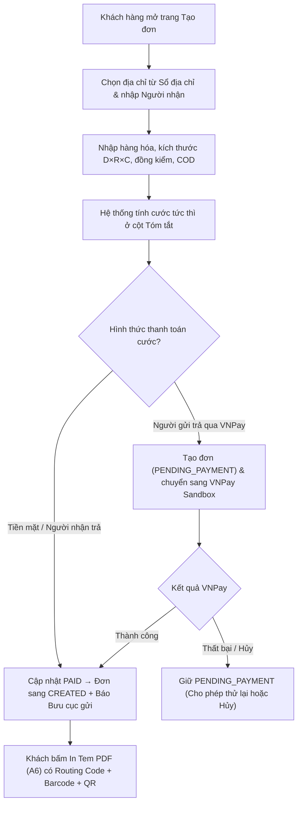
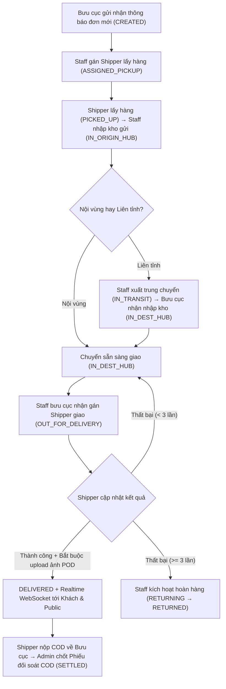

# Tài liệu Yêu cầu Sản phẩm (PRD)
## Dự án: Hệ thống Quản lý Chuỗi Giao nhận Logistic — UTEExpress

---

## 1. Tham khảo Chuẩn Ngành (Industry Benchmarks)

Để trải nghiệm sản phẩm sát thực tế doanh nghiệp vận chuyển tại Việt Nam nhưng vẫn tinh gọn, UTEExpress kế thừa các quy chuẩn UX và vận hành đã được kiểm chứng từ các nền tảng lớn:

| Nền tảng tham khảo | Tính năng / Chuẩn UX được áp dụng vào UTEExpress |
| :--- | :--- |
| **Giao Hàng Nhanh (GHN)** | Form tạo đơn 2 cột với khung **Tóm tắt cước phí cố định (sticky summary)**; cấu hình tài khoản ngân hàng nhận COD trong hồ sơ shop; quy định giao tối đa 3 lần trước khi chuyển hoàn; bảng kê đối soát COD có cấn trừ cước. |
| **Viettel Post** | Ô tra cứu công khai hỗ trợ **nhập nhiều mã vận đơn cùng lúc** (cách nhau bằng dấu phẩy, tối đa 5 mã); tùy chọn **quy định đồng kiểm** (*Cho xem không cho thử / Cho thử / Không cho xem*); công cụ ước tính cước công khai không cần đăng nhập. |
| **GHTK & SPX Express** | Quản lý danh sách đơn theo **Tab trạng thái có bộ đếm (badge count)**; mẫu **tem vận đơn PDF khổ A6 (`105 × 148 mm`)** chuẩn máy in nhiệt có **Mã định tuyến kho lớn (Routing Code)**, Barcode 1D, QR Code, số tiền thu hộ nổi bật và nhãn cảnh báo *Hàng dễ vỡ*. |

---

## 2. Chân dung Người dùng (User Personas)

### 2.1. Persona 1 — Minh Anh (Người nhận hàng / Khách vãng lai)
* **Bối cảnh:** Mua hàng online, được shop gửi mã vận đơn `UTE...`.
* **Mục tiêu:** Kiểm tra nhanh kiện hàng đang ở bưu cục nào, dự kiến bao giờ giao, cần chuẩn bị bao nhiêu tiền mặt mà **không cần đăng ký tài khoản**.
* **Nỗi đau:** Phải F5 trang liên tục hoặc gọi tổng đài hỏi trạng thái đơn.

### 2.2. Persona 2 — Hoàng Nam (Chủ shop online — `CUSTOMER`)
* **Bối cảnh:** Gửi 10–30 đơn/ngày từ TP.HCM đi các tỉnh, hay dùng sổ địa chỉ và cần in tem dán hộp nhanh.
* **Mục tiêu:** Tạo đơn nhanh, thấy ngay cước phí khi đổi gói dịch vụ/trọng lượng, thanh toán online qua VNPay nếu trả cước trước, in tem A6 dán hộp, theo dõi tiền COD đã đối soát hay chưa và chat nhanh với bưu cục khi đơn gặp sự cố.
* **Nỗi đau:** Nhập lại địa chỉ lấy hàng nhiều lần, khó đối chiếu tiền COD và cước phí cấn trừ.

### 2.3. Persona 3 — Thu Hà (Nhân viên vận hành bưu cục — `STAFF`)
* **Bối cảnh:** Làm việc tại Bưu cục Thủ Đức (`HCM-TD01`), xử lý điều phối shipper và hàng trung chuyển mỗi ngày.
* **Mục tiêu:** Nhận thông báo ngay khi có đơn mới thuộc khu vực, phân công shipper lấy/giao nhanh theo danh sách, xác nhận nhập/xuất kho trung chuyển sang bưu cục đích, thu tiền COD từ shipper cuối ngày và trả lời chat khách hàng.
* **Nỗi đau:** Đơn bị sót không phân công hoặc nhầm lẫn hàng của bưu cục khác.

### 2.4. Persona 4 — Văn Hùng (Nhân viên giao nhận — `SHIPPER`)
* **Bối cảnh:** Sử dụng cổng web UTEExpress (giao diện Bootstrap 5 responsive gọn gàng) để quản lý và cập nhật các đơn được phân công trong ngày.
* **Mục tiêu:** Xem rõ danh sách đơn cần lấy / cần giao trong ngày, thấy ngay **số tiền phải thu người nhận** và **chỉ dẫn đồng kiểm**, xác nhận giao thành công kèm upload ảnh POD nhanh chóng và biết chính xác tổng tiền COD đang giữ phải nộp về bưu cục.
* **Nỗi đau:** Giao diện rườm rà, khó phân biệt giữa đơn cần lấy và đơn cần giao.

### 2.5. Persona 5 — Quốc Bảo (Quản trị chuỗi UTEExpress — `ADMIN`)
* **Bối cảnh:** Quản lý toàn mạng lưới bưu cục toàn quốc.
* **Mục tiêu:** Thiết lập chuỗi bưu cục/kho trung chuyển, điều chỉnh bảng giá gói cước, cấp tài khoản cho Staff/Shipper theo từng bưu cục, duyệt phiên đối soát COD cho khách hàng và theo dõi KPI toàn chuỗi (doanh thu, tỷ lệ giao thành công, sản lượng từng bưu cục).

---

## 3. Phân loại Ưu tiên Tính năng (MoSCoW)

| Mức độ | Phạm vi tính năng |
| :--- | :--- |
| **Must-Have (Bắt buộc)** | Đăng ký/Đăng nhập JWT (HttpOnly Cookie) + RBAC 4 vai trò; Quản lý chuỗi Hub & Gói dịch vụ; Tạo đơn + Tính cước tự động (kể cả quy đổi `D×R×C`); Luồng chuyển trạng thái chuỗi đa bưu cục (`CREATED` → `IN_TRANSIT` → `DELIVERED`/`RETURNED`); Thanh toán cước **VNPay Sandbox**; In tem vận đơn **PDF (A6) có Barcode + QR + Routing Code**; Upload ảnh chứng từ **POD** khi giao thành công; **WebSocket** (Live Tracking, Thông báo realtime, Chat CSKH theo đơn); Quản lý & Đối soát **COD** có cấn trừ cước; Trang công khai tra cứu (1–5 mã) & ước tính cước; Dashboard thống kê Admin. |
| **Should-Have (Nên có)** | Sổ địa chỉ gửi/nhận của Khách hàng; Hồ sơ tài khoản ngân hàng nhận COD; Tùy chọn in khổ **A5** bên cạnh khổ mặc định **A6**; Lọc/tìm kiếm vận đơn nâng cao theo từ khóa, khoảng ngày, tab trạng thái có bộ đếm; Giao diện web Bootstrap 5 responsive gọn gàng cho cổng Shipper. |
| **Could-Have (Mở rộng nếu dư thời gian)** | Xuất báo cáo danh sách đơn / bảng kê đối soát ra file CSV/Excel; In hàng loạt nhiều tem vận đơn cùng lúc thành 1 file PDF; Dark mode cho Dashboard quản trị. |
| **Won't-Have (Không làm kỳ này)** | App native iOS/Android; GPS live map xe tải; Nhập đơn hàng loạt từ file Excel; Tích hợp SMS OTP trả phí. |

---

## 4. Đặc tả Chi tiết theo Epic, User Stories & Acceptance Criteria

### EPIC 1: Cổng Công khai (Public Portal — Không cần đăng nhập)

* **US-1.1 — Tra cứu 1 hoặc nhiều vận đơn (chuẩn Viettel Post)**
  * *Là* Khách vãng lai, *tôi muốn* nhập 1 hoặc nhiều mã vận đơn (cách nhau bởi dấu phẩy, tối đa 5 mã) để kiểm tra nhanh tình trạng giao hàng.
  * **Acceptance Criteria (AC):**
    1. Nhập 1 mã hợp lệ → hiển thị thẻ tóm tắt + thanh tiến độ trực quan (Stepper) + danh sách lịch sử hành trình theo thứ tự mới nhất lên trên.
    2. Nhập nhiều mã (VD: `UTE..., UTE...`, tối đa 5 mã) → hiển thị danh sách kết quả từng mã và cho phép bấm mở rộng timeline chi tiết của từng đơn; báo rõ mã nào không tồn tại.
    3. Che thông tin nhạy cảm theo `BR-11` (VD: SĐT hiển thị `090****789`, tên hiển thị `Nguyễn Văn ***`, ẩn số tiền COD và ảnh POD trên trang công khai).
    4. Tự động kết nối WebSocket cho mã đang xem: khi Staff/Shipper đổi trạng thái, timeline và badge trạng thái **tự cập nhật tức thì không cần F5**.

* **US-1.2 — Công cụ ước tính cước vận chuyển công khai**
  * *Là* Khách vãng lai/Chủ shop, *tôi muốn* nhập tỉnh gửi, tỉnh nhận, trọng lượng, kích thước tùy chọn (`D×R×C`) và tiền COD để xem bảng so sánh giá giữa các gói dịch vụ (*Tiêu chuẩn*, *Nhanh*, *Hỏa tốc*).
  * **AC:**
    1. Hiển thị đồng thời bảng giá & thời gian dự kiến của tất cả gói dịch vụ đang hoạt động.
    2. Nếu có nhập `D × R × C`, hiển thị rõ *Trọng lượng quy đổi* và *Trọng lượng tính cước* theo `BR-03`.
    3. Có nút **"Tạo đơn với gói này"** điều hướng sang trang tạo đơn (hoặc trang đăng nhập nếu chưa đăng nhập).

* **US-1.3 — Tra cứu mạng lưới chuỗi bưu cục UTEExpress**
  * *Là* Người dùng, *tôi muốn* lọc danh sách bưu cục theo Tỉnh/Thành phố để biết địa chỉ và giờ hoạt động gần mình nhất.
  * **AC:** Lọc được theo Tỉnh/Thành và loại hình (`Bưu cục` / `Kho trung chuyển`), hiển thị mã bưu cục, địa chỉ, hotline.

---

### EPIC 2: Định danh, Sổ địa chỉ & Hồ sơ Ngân hàng COD

* **US-2.1 — Đăng ký & Đăng nhập bằng JWT**
  * *Là* Khách hàng mới, *tôi muốn* đăng ký tài khoản bằng email/SĐT và đăng nhập an toàn để sử dụng cổng gửi hàng.
  * **AC:**
    1. Đăng ký tự động gán vai trò `CUSTOMER`, kiểm tra trùng email/SĐT, mật khẩu mã hóa BCrypt (tối thiểu 6 ký tự).
    2. Đăng nhập thành công cấp JWT lưu trong `HttpOnly Cookie` và điều hướng về đúng trang chủ theo vai trò (`ADMIN` → `/admin`, `STAFF` → `/staff`, `SHIPPER` → `/shipper`, `CUSTOMER` → `/customer`).
    3. Đăng xuất xóa cookie JWT và không thể truy cập lại trang bảo mật bằng nút Back.

* **US-2.2 — Quản lý Sổ địa chỉ & Tài khoản Ngân hàng nhận COD (chuẩn GHN)**
  * *Là* Khách hàng, *tôi muốn* lưu sẵn nhiều địa chỉ lấy/giao thường dùng và thông tin tài khoản ngân hàng nhận COD.
  * **AC:**
    1. Thêm/sửa/xóa/đặt địa chỉ mặc định trong sổ địa chỉ; chọn nhanh khi tạo đơn.
    2. Cập nhật được `Tên ngân hàng`, `Số tài khoản`, `Tên chủ tài khoản` trong mục Hồ sơ; thông tin này tự động hiển thị trên các phiếu đối soát COD.

---

### EPIC 3: Cổng Khách hàng — Tạo đơn, Thanh toán VNPay & In Tem PDF A6

* **US-3.1 — Tạo vận đơn mới (UX 2 cột chuẩn GHN)**
  * *Là* Khách hàng, *tôi muốn* điền thông tin đơn hàng và thấy cước phí tự động tính theo thời gian thực ở cột tóm tắt bên phải trước khi bấm tạo.
  * **AC:**
    1. Form chia 4 khối rõ ràng: *(1) Người gửi (lấy từ sổ địa chỉ hoặc nhập mới)*, *(2) Người nhận*, *(3) Hàng hóa (tên hàng, khối lượng, tùy chọn `D×R×C`, cờ "Hàng dễ vỡ", tùy chọn Đồng kiểm chuẩn GHN/ViettelPost)*, *(4) Dịch vụ, COD, Người trả cước (`SENDER`/`RECEIVER`) & Phương thức thanh toán (`CASH`/`VNPAY`)*.
    2. Tự động chọn bưu cục gửi (`origin_hub`) và bưu cục nhận (`dest_hub`) theo tỉnh/khu vực; hiển thị rõ tuyến *Nội vùng* hay *Liên tỉnh*.
    3. Mỗi khi thay đổi gói dịch vụ / trọng lượng / kích thước / COD / tỉnh nhận, API tính cước cập nhật bảng tổng kết ngay lập tức mà không tải lại trang.
    4. Nếu chọn `Người gửi trả` + `Tiền mặt` hoặc `Người nhận trả`: tạo đơn ở trạng thái `CREATED` ngay lập tức và bắn thông báo WebSocket tới bưu cục gửi.
    5. Nếu chọn `Người gửi trả` + `VNPay Sandbox`: tạo đơn ở trạng thái `PENDING_PAYMENT` và chuyển hướng thẳng sang cổng thanh toán VNPay Sandbox.

* **US-3.2 — Thanh toán cước trực tuyến qua VNPay Sandbox**
  * *Là* Khách hàng, *tôi muốn* thanh toán cước đơn hàng bằng thẻ test VNPay Sandbox và thấy đơn tự động chuyển sang trạng thái chờ lấy hàng.
  * **AC:**
    1. Hệ thống ký yêu cầu thanh toán bằng `HMAC-SHA512` đúng chuẩn VNPay API v2.1.0.
    2. Khi VNPay trả về `Return URL` (hoặc gọi `IPN`): xác thực chữ ký hợp lệ, kiểm tra mã giao dịch & số tiền khớp, cập nhật `payment_status = PAID` và chuyển trạng thái đơn từ `PENDING_PAYMENT` → `CREATED` (chỉ xử lý 1 lần — idempotent).
    3. Nếu thanh toán thất bại/hủy: giữ nguyên `PENDING_PAYMENT`, hiển thị thông báo rõ ràng kèm nút **"Thanh toán lại qua VNPay"** hoặc **"Hủy đơn"**.

* **US-3.3 — Xuất & In Tem Vận đơn PDF (Khổ A6 mặc định, hỗ trợ A5)**
  * *Là* Khách hàng hoặc Nhân viên bưu cục, *tôi muốn* tải/in tem vận đơn PDF chuẩn để dán lên kiện hàng.
  * **AC:**
    1. File PDF khổ A6 (`105 × 148 mm`, có tùy chọn `?size=A5`) chứa đầy đủ chuẩn GHN/GHTK/SPX:
       * Logo **UTEExpress** + Tên gói dịch vụ (*Nhanh / Tiêu chuẩn / Hỏa tốc*).
       * **Mã định tuyến kho (Routing Code)** in lớn, đậm (VD: `HCM-TD01 → HN-CG01`).
       * **Barcode 1D (Code128)** + chuỗi mã vận đơn `UTE...`.
       * **QR Code** chứa đường dẫn trực tiếp đến trang tra cứu `/tracking?codes=UTE...`.
       * Khối thông tin Người gửi & Người nhận (tên, SĐT, địa chỉ đầy đủ).
       * Thông tin hàng hóa (tên hàng, trọng lượng), nhãn nổi bật `[HÀNG DỄ VỠ]` (nếu có) và chỉ dẫn đồng kiểm.
       * Khối nổi bật **TIỀN THU NGƯỜI NHẬN** (`COD + cước nếu người nhận trả`, hoặc `0 VNĐ — ĐÃ THANH TOÁN`).
       * Ô chữ ký người nhận và ghi chú quy định hoàn hàng sau 3 lần phát.
    2. Chỉ chủ sở hữu vận đơn, Staff thuộc hub liên quan hoặc Admin mới được tải file PDF của vận đơn đó.

* **US-3.4 — Quản lý, Lọc, Xem chi tiết (kèm ảnh POD) & Hủy đơn**
  * *Là* Khách hàng, *tôi muốn* theo dõi toàn bộ đơn của mình theo từng tab trạng thái, xem ảnh POD sau khi giao và hủy đơn nếu chưa lấy hàng.
  * **AC:**
    1. Có thanh tab trạng thái kèm số lượng đơn (*Tất cả | Chờ thanh toán | Chờ lấy | Đang trung chuyển | Đang giao | Thành công | Giao thất bại / Hoàn | Đã hủy*) + tìm theo mã/SĐT người nhận + lọc khoảng ngày.
    2. Trang chi tiết hiển thị đầy đủ timeline realtime, thông tin thanh toán, ảnh POD (khi `DELIVERED`) có thể bấm phóng to (lightbox), nút In tem PDF và khung Chat CSKH.
    3. Nút **"Hủy đơn"** chỉ hiển thị khi trạng thái thuộc `{PENDING_PAYMENT, CREATED, ASSIGNED_PICKUP}` (theo `BR-05`). Nếu đơn đã trả VNPay, đánh dấu `payment_status = REFUND_PENDING`.

---

### EPIC 4: Cổng Nhân viên Bưu cục (Staff Portal — Điều phối Chuỗi Hub)

* **US-4.1 — Tiếp nhận & Phân công Shipper lấy hàng (tại Bưu cục gửi)**
  * *Là* Staff bưu cục, *tôi muốn* xem các đơn `CREATED` thuộc bưu cục mình và gán cho 1 Shipper trực thuộc bưu cục đi lấy hàng.
  * **AC:**
    1. Chỉ hiển thị danh sách Shipper đang hoạt động thuộc **cùng `hub_id`** với Staff.
    2. Sau khi gán, đơn chuyển sang `ASSIGNED_PICKUP`, ghi tracking log và gửi thông báo realtime WebSocket tới Shipper đó.

* **US-4.2 — Nhập kho gửi, Xuất kho Trung chuyển & Nhập kho nhận (Luồng Chuỗi Đa Hub)**
  * *Là* Staff bưu cục, *tôi muốn* xác nhận nhập/xuất kho giữa các bưu cục trong chuỗi để cập nhật đúng vị trí kiện hàng.
  * **AC:**
    1. **Tại Bưu cục gửi:** Đơn `PICKED_UP` → Staff xác nhận **Nhập kho gửi (`IN_ORIGIN_HUB`)**.
       * Nếu là đơn **Nội vùng** (`origin_hub == dest_hub`): hệ thống chuyển thẳng sang sẵn sàng phân công giao (trạng thái `IN_DEST_HUB` hoặc cho phép phân công shipper giao ngay).
       * Nếu là đơn **Liên tỉnh** (`origin_hub != dest_hub`): Staff chọn **Xuất kho trung chuyển (`IN_TRANSIT`)** đến `dest_hub`.
    2. **Tại Bưu cục nhận:** Staff thấy đơn đang đến bưu cục mình ở tab *"Hàng đang trung chuyển đến"* → bấm **Xác nhận nhập bưu cục nhận (`IN_DEST_HUB`)** → `current_hub` cập nhật thành `dest_hub`.
    3. Mọi bước nhập/xuất kho đều ghi nhận `shipment_tracking_logs` (bưu cục, nhân viên, thời gian, ghi chú) và phát realtime qua WebSocket.

* **US-4.3 — Phân công Shipper giao hàng & Xử lý đơn Giao thất bại / Hoàn hàng**
  * *Là* Staff bưu cục nhận, *tôi muốn* gán shipper giao chặng cuối và xử lý các đơn giao thất bại.
  * **AC:**
    1. Đơn ở `IN_DEST_HUB` → gán Shipper trực thuộc bưu cục nhận → chuyển sang `OUT_FOR_DELIVERY` + thông báo realtime tới Shipper và Khách hàng.
    2. Với đơn ở `DELIVERY_FAILED`:
       * Nếu `failed_delivery_count < 3`: cho phép bấm **"Sắp xếp giao lại"** (phân công shipper → `OUT_FOR_DELIVERY`) hoặc **"Chuyển hoàn"** (nếu khách từ chối nhận).
       * Nếu `failed_delivery_count >= 3`: khóa nút giao lại, chỉ cho phép kích hoạt **"Bắt đầu hoàn hàng"** (`RETURNING` → `RETURNED`).

---

### EPIC 5: Cổng Web Shipper & Bằng chứng Giao hàng (POD)

* **US-5.1 — Danh sách tác vụ lấy hàng & giao hàng trên web**
  * *Là* Shipper, *tôi muốn* xem danh sách việc cần làm theo 3 tab rõ ràng (*Cần lấy* | *Cần giao* | *Đã hoàn thành / COD*) với giao diện web Bootstrap 5 gọn nhẹ, dễ thao tác.
  * **AC:**
    1. Mỗi dòng/thẻ đơn hiển thị nổi bật: Mã vận đơn, Tên & SĐT khách, Địa chỉ, **Tổng tiền cần thu người nhận**, **Chỉ dẫn đồng kiểm** và nhãn *Hàng dễ vỡ* (nếu có).
    2. Tại tab *Cần lấy*: bấm **"Xác nhận đã lấy hàng"** → `ASSIGNED_PICKUP` → `PICKED_UP`.

* **US-5.2 — Xác nhận Giao thành công kèm Ảnh POD & Báo Giao thất bại**
  * *Là* Shipper, *tôi muốn* tải ảnh chứng từ giao hàng khi giao xong hoặc chọn nhanh lý do khi giao không thành công.
  * **AC:**
    1. Bấm **"Giao thành công"** mở modal bắt buộc chọn/chụp ảnh POD (`JPG/PNG/WEBP`, `<= 5MB`, có preview ảnh trước khi gửi). Không có ảnh thì không cho submit (`BR-07`).
    2. Submit thành công: upload ảnh lên **Cloudflare R2**, lưu object key ảnh POD vào đơn, chuyển trạng thái `DELIVERED`, ghi nhận tiền Shipper đang giữ (nếu có COD hoặc người nhận trả cước), phát realtime WebSocket cho Khách hàng và Public Tracking.
    3. Bấm **"Giao thất bại"** mở modal chọn lý do mẫu (*Khách không nghe máy / Sai địa chỉ / Hẹn giao lại / Khách từ chối nhận*) + ghi chú → tăng `failed_delivery_count + 1`, chuyển sang `DELIVERY_FAILED` và thông báo cho Staff bưu cục nhận & Khách hàng.

---

### EPIC 6: Tính năng Realtime (WebSocket STOMP)

* **US-6.1 — Trung tâm Thông báo đẩy Realtime**
  * *Là* Người dùng đã đăng nhập (Customer / Staff / Shipper / Admin), *tôi muốn* nhận thông báo tức thì ở biểu tượng chuông trên thanh điều hướng khi có sự kiện liên quan đến mình.
  * **AC:**
    1. Badge số thông báo chưa đọc tự tăng realtime kèm toast popup góc màn hình.
    2. Bấm vào thông báo đánh dấu đã đọc và mở thẳng trang chi tiết vận đơn / phiên đối soát tương ứng.

* **US-6.2 — Chat Hỗ trợ CSKH gắn theo Mã Vận đơn**
  * *Là* Khách hàng và Nhân viên bưu cục, *tôi muốn* trao đổi trực tiếp theo từng vận đơn để giải quyết nhanh các vấn đề đổi giờ giao, sai địa chỉ hoặc khiếu nại.
  * **AC:**
    1. Giao diện chi tiết vận đơn của Khách hàng và Staff có khung Chat gắn theo `shipmentId`.
    2. Tin nhắn gửi/nhận tức thì qua WebSocket, lưu lịch sử vào PostgreSQL (`chat_messages`), hiển thị tên người gửi, vai trò và thời gian.
    3. Chỉ Khách tạo đơn, Staff của bưu cục liên quan (`origin_hub`/`dest_hub`/`current_hub`) và Admin mới được xem và nhắn trong phòng chat của đơn đó.

---

### EPIC 7: Quản lý Dòng tiền & Đối soát COD (Chuẩn GHN / Viettel Post)

* **US-7.1 — Nộp tiền COD từ Shipper về Bưu cục**
  * *Là* Shipper và Staff bưu cục, *tôi muốn* đối chiếu và xác nhận khoản tiền COD mà Shipper đã thu hộ để bàn giao về bưu cục.
  * **AC:**
    1. Shipper xem được danh sách các đơn đã giao thành công có tiền thu hộ chưa nộp (`cod_status = HELD_BY_SHIPPER`) và tổng tiền phải nộp.
    2. Staff bưu cục chọn các đơn của Shipper và bấm **"Xác nhận đã thu tiền từ Shipper"** → chuyển `cod_status = COLLECTED_BY_HUB` (ghi nhận thời gian và nhân viên thu).

* **US-7.2 — Tạo & Duyệt Phiếu Đối soát COD cho Khách hàng**
  * *Là* Admin/Staff và Khách hàng, *tôi muốn* lập bảng kê đối soát COD theo từng khách hàng (có tự động cấn trừ cước chưa thanh toán) và theo dõi trạng thái chuyển khoản.
  * **AC:**
    1. Admin chọn Khách hàng có các đơn `DELIVERED` & `cod_status = COLLECTED_BY_HUB` chưa đối soát → hệ thống tự tổng hợp:
       * `Tổng tiền COD thu hộ`
       * `Tổng cước phí khấu trừ` (các đơn người gửi trả nhưng chưa thanh toán VNPay)
       * `Số tiền thực chuyển = Tổng COD - Tổng cước khấu trừ`
       * Thông tin tài khoản ngân hàng của Khách hàng.
    2. Tạo **Phiếu đối soát (`PENDING`)** → Admin bấm **"Xác nhận đã chuyển khoản (`SETTLED`)"** kèm mã giao dịch tham chiếu → toàn bộ vận đơn trong phiếu đổi `cod_status = SETTLED` và bắn thông báo realtime cho Khách hàng.
    3. Khách hàng xem được toàn bộ lịch sử bảng kê đối soát và danh sách đơn chi tiết nằm trong từng phiếu.

---

### EPIC 8: Quản trị Chuỗi (Admin Portal) & Dashboard Thống kê

* **US-8.1 — Quản lý Mạng lưới Chuỗi Bưu cục (Hub CRUD)**
  * *Là* Admin, *tôi muốn* thêm/sửa/tạm ngưng các bưu cục và kho trung chuyển trong chuỗi UTEExpress.
  * **AC:** Quản lý mã hub duy nhất (VD: `HCM-TD01`, `HN-CG01`), tên, loại (`POST_OFFICE`/`SORTING_HUB`), tỉnh/thành, quận/huyện, địa chỉ, hotline, trạng thái hoạt động. Không cho phép xóa cứng hub đang có vận đơn/nhân viên (chỉ cho vô hiệu hóa `INACTIVE`).

* **US-8.2 — Quản lý Gói dịch vụ & Bảng giá cước**
  * *Là* Admin, *tôi muốn* cấu hình cước cơ bản, khối lượng chuẩn, đơn giá vượt mức, phụ phí liên vùng, % phí COD và thời gian giao dự kiến cho từng gói dịch vụ.
  * **AC:** Thay đổi bảng giá chỉ áp dụng cho các đơn tạo mới về sau, **không làm thay đổi cước của các đơn đã tạo trước đó**.

* **US-8.3 — Quản lý Tài khoản & Gán Bưu cục**
  * *Là* Admin, *tôi muốn* tạo tài khoản `STAFF` / `SHIPPER` (gắn vào `hub_id` cụ thể), xem danh sách `CUSTOMER` và khóa/mở khóa tài khoản vi phạm.
  * **AC:** Không cho phép tạo `STAFF`/`SHIPPER` mà bỏ trống `hub_id`; tài khoản bị khóa (`LOCKED`) bị từ chối đăng nhập ngay lập tức.

* **US-8.4 — Dashboard Điều hành & Biểu đồ Thống kê**
  * *Là* Admin, *tôi muốn* theo dõi tình hình kinh doanh toàn chuỗi trực quan qua số liệu KPI và biểu đồ.
  * **AC:**
    1. Thẻ KPI tổng quan (lọc theo 7 ngày / 30 ngày / Tháng này / Tùy chọn): Tổng số đơn, Doanh thu cước phí, Tỷ lệ giao thành công (%), Tổng COD đang chờ đối soát.
    2. Biểu đồ (Chart.js):
       * Biểu đồ cột/đường: Sản lượng đơn & Doanh thu cước theo ngày.
       * Biểu đồ tròn (Doughnut): Tỷ lệ trạng thái đơn hàng (*Thành công / Đang xử lý / Hoàn / Hủy*).
       * Bảng xếp hạng / Biểu đồ ngang: Sản lượng xử lý theo từng Bưu cục trong chuỗi.

---

## 5. Luồng Trải nghiệm Chính (Key User Journeys)

### 5.1. Luồng Tạo đơn → Thanh toán VNPay → In Tem A6

### 5.2. Luồng Vận hành Đa Bưu cục → Giao hàng POD → Đối soát COD

---

## 6. Chỉ số Thành công Sản phẩm (Product Success Metrics)
* **Thời gian tạo đơn:** Khách hàng đã có địa chỉ mặc định tạo xong 1 vận đơn và xuất được tem PDF trong `< 60 giây`.
* **Tính tức thời:** 100% sự kiện đổi trạng thái vận đơn, phân công shipper và tin nhắn CSKH phản hồi trên giao diện người dùng qua WebSocket không cần tải lại trang.
* **Trải nghiệm Web Shipper:** Các thao tác lấy hàng / giao thành công kèm ảnh POD / báo giao thất bại chạy mượt trên trình duyệt web (cả màn hình desktop lẫn responsive thu nhỏ bằng Bootstrap 5).
