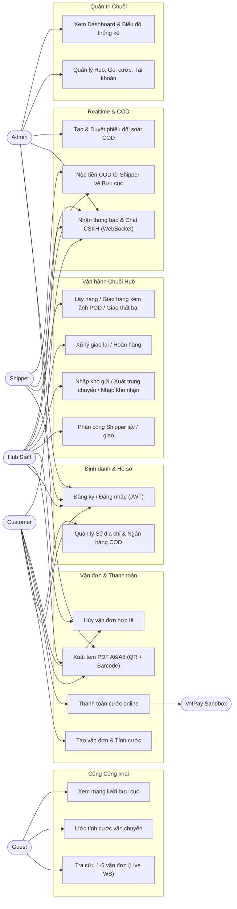
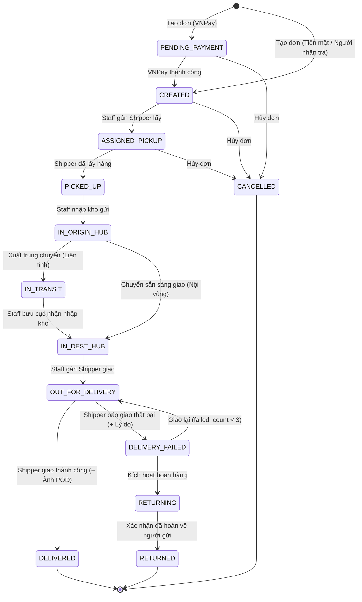
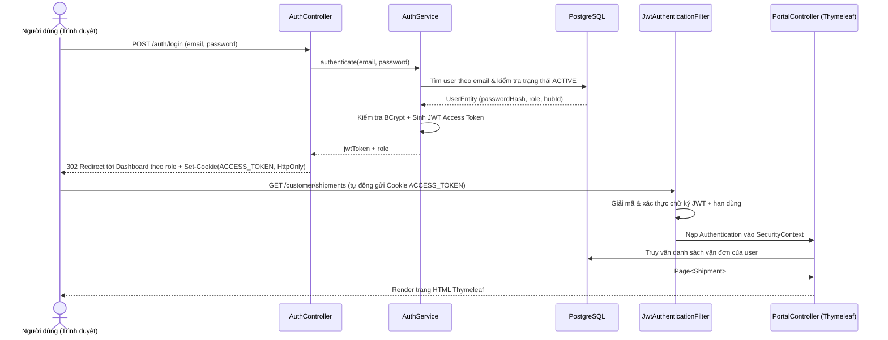
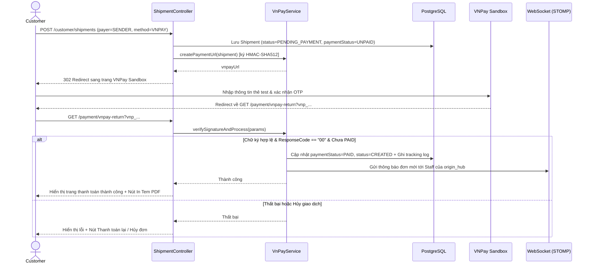
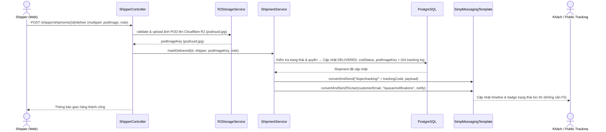
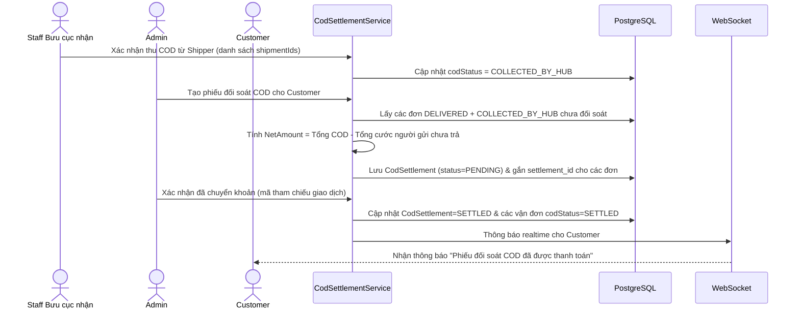

# Đặc tả Yêu cầu Phần mềm (SRS)
## Dự án: Hệ thống Quản lý Chuỗi Giao nhận Logistic — UTEExpress

---

## 1. Tổng quan Hệ thống & Các Tác nhân (Actors)

UTEExpress là ứng dụng web đơn khối phân tầng (**Spring Boot 3 + Thymeleaf + Bootstrap 5**) kết nối **PostgreSQL 16** (chạy qua Docker Compose), xác thực bằng **JWT (HttpOnly Cookie)** và giao tiếp thời gian thực bằng **WebSocket (STOMP/SockJS)**.

### 1.1. Danh sách Tác nhân
* **Guest (Khách vãng lai):** Người dùng chưa đăng nhập (tra cứu vận đơn, ước tính cước, xem mạng lưới bưu cục).
* **Customer (`CUSTOMER`):** Chủ shop / người gửi hàng.
* **Staff (`STAFF`):** Nhân viên vận hành trực thuộc 1 bưu cục (`hub_id`).
* **Shipper (`SHIPPER`):** Nhân viên lấy/giao hàng trực thuộc 1 bưu cục (`hub_id`).
* **Admin (`ADMIN`):** Quản trị viên toàn chuỗi UTEExpress.
* **VNPay Sandbox (External System):** Cổng thanh toán trực tuyến kiểm thử (Return URL & IPN).

### 1.2. Sơ đồ Use Case Tổng quan

---

## 2. Yêu cầu Chức năng (Functional Requirements)

| Mã FR | Phân hệ | Đặc tả chi tiết |
| :--- | :--- | :--- |
| **FR-01** | **Xác thực & Phân quyền (JWT)** | - Đăng ký tài khoản mới mặc định role `CUSTOMER`, mã hóa mật khẩu bằng `BCrypt`. - Đăng nhập sinh **JWT Access Token** (hạn 24 giờ) chứa `userId`, `email`, `role`, `hubId` và lưu vào **HttpOnly Cookie** (`ACCESS_TOKEN`). - Filter bảo mật đọc JWT từ Cookie (hoặc header `Authorization: Bearer`) để xác thực stateless cho cả trang Thymeleaf, REST API và kết nối WebSocket. - Tài khoản trạng thái `LOCKED` bị chặn đăng nhập ngay lập tức. |
| **FR-02** | **Cổng Công khai (Public)** | - Tra cứu cùng lúc từ 1 đến 5 mã vận đơn (phân cách bởi dấu phẩy). Tự động che thông tin nhạy cảm (SĐT dạng `090****789`, ẩn COD và ảnh POD). - Công cụ ước tính cước công khai cho tất cả gói dịch vụ đang `ACTIVE`. - Danh sách bưu cục UTEExpress có lọc theo Tỉnh/Thành và loại bưu cục. |
| **FR-03** | **Quản lý Hồ sơ, Sổ địa chỉ & Ngân hàng** | - Customer thêm/sửa/xóa/chọn mặc định địa chỉ lấy và giao hàng. - Customer khai báo thông tin ngân hàng nhận tiền COD (`bankName`, `bankAccountNumber`, `bankAccountHolder`). |
| **FR-04** | **Tạo vận đơn & Tính cước tự động** | - Tính trọng lượng quy đổi: nếu có `D, R, C (cm)` thì `volumetricWeight = (D * R * C) / 5000.0`; `chargeableWeight = ceilToHalfKg(max(actualWeight, volumetricWeight))`. - Tự động gán `origin_hub` và `dest_hub` theo tỉnh/khu vực; đánh dấu đơn nội vùng (`origin_hub == dest_hub`) hoặc liên tỉnh (`origin_hub != dest_hub`). - Lưu đầy đủ: thông tin gửi/nhận, hàng hóa, cờ `isFragile`, tùy chọn đồng kiểm (`inspectionPolicy`), gói dịch vụ, cước vận chuyển, phí COD, `payerType` (`SENDER`/`RECEIVER`), `paymentMethod` (`CASH`/`VNPAY`). - Sinh mã vận đơn duy nhất `UTE` + `YYMMDD` + `6 ký tự ngẫu nhiên`. |
| **FR-05** | **Thanh toán cước VNPay Sandbox** | - Với đơn `payerType = SENDER` và `paymentMethod = VNPAY`: tạo đơn trạng thái `PENDING_PAYMENT`, tạo URL thanh toán VNPay API v2.1.0 ký bằng `HMAC-SHA512`. - Xử lý cả `Return URL` và `IPN Endpoint`: xác thực chữ ký, kiểm tra số tiền và mã giao dịch khớp, đảm bảo chỉ cập nhật 1 lần (**idempotent**). Thành công → `paymentStatus = PAID`, `status = CREATED`, ghi tracking log và báo WebSocket tới bưu cục gửi. - Nếu chưa thanh toán, hỗ trợ bấm thanh toán lại hoặc hủy đơn. |
| **FR-06** | **Xuất Tem Vận đơn PDF (A6 / A5)** | - Sinh PDF trên server bằng **OpenPDF + ZXing** (khổ mặc định `A6: 105 × 148 mm`, hỗ trợ `?size=A5`). - Nội dung tem gồm: Logo UTEExpress, gói dịch vụ, **Routing Code** (`originHub.code → destHub.code`), **Barcode Code128**, **QR Code** trỏ tới URL tra cứu, thông tin gửi/nhận, tên hàng & trọng lượng, nhãn `[HÀNG DỄ VỠ]` (nếu có), chỉ dẫn đồng kiểm, **Tổng tiền thu người nhận** và ô chữ ký. - Kiểm tra quyền tải PDF: chỉ chủ đơn, Staff hub liên quan hoặc Admin. |
| **FR-07** | **Điều phối & Luân chuyển Chuỗi Hub** | - Staff bưu cục chỉ thao tác các đơn liên quan tới `hub_id` của mình (`origin_hub`, `dest_hub`, hoặc `current_hub`). - Hỗ trợ trọn vẹn các thao tác: gán Shipper lấy hàng, xác nhận nhập bưu cục gửi, xuất kho trung chuyển liên tỉnh, xác nhận nhập bưu cục nhận, gán Shipper giao hàng, xử lý giao lại (`failed_delivery_count < 3`) hoặc chuyển hoàn (`RETURNING` → `RETURNED`). - Mọi chuyển đổi trạng thái phải qua hàm kiểm tra hợp lệ và ghi 1 dòng vào `shipment_tracking_logs`. |
| **FR-08** | **Tác vụ Shipper & Ảnh POD** | - Giao diện web Bootstrap 5 chia tab *Cần lấy / Cần giao / Đã giao & COD*. - Xác nhận lấy hàng (`ASSIGNED_PICKUP → PICKED_UP`). - Xác nhận giao thành công (`OUT_FOR_DELIVERY → DELIVERED`): **bắt buộc** upload ảnh POD (`JPG/PNG/WEBP`, tối đa `5MB`), đẩy lên **Cloudflare R2** với object key `pod/{UUID}.{ext}` và lưu object key vào DB. - Xác nhận giao thất bại (`OUT_FOR_DELIVERY → DELIVERY_FAILED`): bắt buộc chọn/nhập lý do và tăng `failed_delivery_count`. |
| **FR-09** | **Realtime WebSocket (Tracking, Notify, Chat)** | - Sử dụng Spring WebSocket + STOMP + SockJS với Simple In-Memory Broker (không dùng broker ngoài). - **Live Tracking:** phát sự kiện cập nhật tới `/topic/tracking/{trackingCode}` mỗi khi trạng thái đơn thay đổi. - **Thông báo đẩy:** lưu vào bảng `notifications` và đẩy tới `/user/queue/notifications` cho người nhận liên quan. - **Chat CSKH:** lưu tin nhắn vào `chat_messages` và đẩy tới `/topic/chat/{shipmentId}` (chặn quyền truy cập nếu không thuộc chủ đơn / Staff hub liên quan / Admin). |
| **FR-10** | **Quản lý COD & Quản trị Chuỗi (Admin)** | - Khi đơn `DELIVERED` có `COD > 0` (hoặc người nhận trả cước): đánh dấu `codStatus = HELD_BY_SHIPPER` → Staff xác nhận thu tiền từ Shipper (`COLLECTED_BY_HUB`) → Admin tạo **Phiếu đối soát (`cod_settlements`)** tự động cấn trừ cước chưa thanh toán → Duyệt đã chuyển khoản (`SETTLED`). - Admin quản lý CRUD chuỗi `Hub`, `ServiceType`, `User` (gán `hub_id` cho Staff/Shipper, khóa/mở tài khoản) và xem Dashboard thống kê (KPI + biểu đồ Chart.js lọc theo khoảng ngày). |

---

## 3. Yêu cầu Phi chức năng (Non-Functional Requirements)

| Mã NFR | Tiêu chí | Yêu cầu cụ thể (Thực tế, không over-engineering) |
| :--- | :--- | :--- |
| **NFR-01** | **Bảo mật (Security)** | Mật khẩu băm bằng `BCrypt`; JWT ký `HS256` bằng secret tối thiểu 256-bit nạp từ biến môi trường `.env`; Cookie gắn cờ `HttpOnly`, `SameSite=Lax`; kiểm tra phân quyền ở cả URL filter và tầng Service (chặn IDOR — xem/sửa đơn của người khác hoặc hub khác). |
| **NFR-02** | **Toàn vẹn dữ liệu** | Mọi nghiệp vụ ghi nhiều bảng (tạo đơn + tracking log; đổi trạng thái + log + thông báo; chốt đối soát COD + cập nhật các vận đơn) phải bọc trong `@Transactional`. Tiền tệ dùng `BigDecimal` (`NUMERIC(15,0)` hoặc `NUMERIC(15,2)` trong PostgreSQL). |
| **NFR-03** | **An toàn Upload File (POD)** | Chỉ chấp nhận ảnh `image/jpeg`, `image/png`, `image/webp`; giới hạn tối đa `5MB`; đổi tên file bằng `UUID` để chống ghi đè và chống path traversal (`../`). |
| **NFR-04** | **Hiệu năng & Trải nghiệm Web** | Phân trang (`Pageable`) cho tất cả danh sách vận đơn, đối soát và người dùng; tạo index PostgreSQL cho các cột tra cứu thường xuyên (`tracking_code`, `status`, `customer_id`, `current_hub_id`). Giao diện sử dụng Bootstrap 5 chuẩn responsive, chạy ổn định trên trình duyệt Chrome/Edge hiện đại. |
| **NFR-05** | **Khả năng triển khai & Bảo trì** | Database PostgreSQL 16 chạy bằng 1 lệnh `docker compose up -d` (chỉ 1 service DB gọn nhẹ); ảnh POD lưu tập trung trên Cloudflare R2; schema & dữ liệu mẫu quản lý bằng **Flyway**; cấu trúc code theo mô hình phân tầng chuẩn Spring Boot (`controller`, `service`, `repository`, `entity`, `dto`, `config`). |

---

## 4. Máy Trạng thái Vận đơn (Shipment State Machine)

### 4.1. Sơ đồ Chuyển đổi Trạng thái

### 4.2. Bảng Quy định Quyền & Điều kiện Chuyển Trạng thái

> *Cài đặt gọn nhẹ trong Java bằng `Map<ShipmentStatus, Set<ShipmentStatus>>` ở tầng Service (không dùng thư viện state machine phức tạp).*

| Trạng thái hiện tại | Trạng thái đích hợp lệ | Ai được thực hiện | Điều kiện / Hành động đi kèm |
| :--- | :--- | :--- | :--- |
| `PENDING_PAYMENT` | `CREATED` | Hệ thống (VNPay callback) | Xác thực chữ ký HMAC-SHA512 thành công → `paymentStatus = PAID`. |
| `PENDING_PAYMENT` | `CANCELLED` | Customer (chủ đơn), Staff, Admin | Không cần hoàn tiền vì chưa thanh toán. |
| `CREATED` | `ASSIGNED_PICKUP` | Staff (`origin_hub`), Admin | Chọn `pickup_shipper_id` thuộc `origin_hub`. |
| `CREATED` | `CANCELLED` | Customer (chủ đơn), Staff, Admin | Nếu `paymentStatus == PAID` → chuyển `REFUND_PENDING`. |
| `ASSIGNED_PICKUP` | `PICKED_UP` | Shipper (`pickup_shipper_id`) | Ghi thời điểm lấy hàng. |
| `ASSIGNED_PICKUP` | `CANCELLED` | Customer (chủ đơn), Staff, Admin | Nếu `paymentStatus == PAID` → chuyển `REFUND_PENDING`. |
| `PICKED_UP` | `IN_ORIGIN_HUB` | Staff (`origin_hub`), Admin | Cập nhật `current_hub = origin_hub`. |
| `IN_ORIGIN_HUB` | `IN_TRANSIT` | Staff (`origin_hub`), Admin | Chỉ áp dụng khi `origin_hub != dest_hub`. |
| `IN_ORIGIN_HUB` | `IN_DEST_HUB` | Staff (`origin_hub`), Admin | Chỉ áp dụng khi `origin_hub == dest_hub` (đơn nội vùng). |
| `IN_TRANSIT` | `IN_DEST_HUB` | Staff (`dest_hub`), Admin | Cập nhật `current_hub = dest_hub`. |
| `IN_DEST_HUB` | `OUT_FOR_DELIVERY` | Staff (`dest_hub`), Admin | Chọn `delivery_shipper_id` thuộc `dest_hub`. |
| `OUT_FOR_DELIVERY` | `DELIVERED` | Shipper (`delivery_shipper_id`) | **Bắt buộc** có ảnh POD. Nếu có tiền thu hộ/thu cước → `codStatus = HELD_BY_SHIPPER`. |
| `OUT_FOR_DELIVERY` | `DELIVERY_FAILED` | Shipper (`delivery_shipper_id`) | Bắt buộc ghi lý do; tăng `failed_delivery_count += 1`. |
| `DELIVERY_FAILED` | `OUT_FOR_DELIVERY` | Staff (`dest_hub`), Admin | Chỉ cho phép khi `failed_delivery_count < 3`. |
| `DELIVERY_FAILED` | `RETURNING` | Staff (`dest_hub`), Admin | Khi `failed_delivery_count >= 3` hoặc người nhận từ chối nhận. |
| `RETURNING` | `RETURNED` | Staff (`origin_hub`/`dest_hub`), Admin | Hoàn tất trả hàng cho người gửi. |

### 4.3. Trạng thái Thanh toán Cước & Trạng thái COD
* **`PaymentStatus`:** `UNPAID` (Chưa thanh toán) | `PAID` (Đã thanh toán) | `REFUND_PENDING` (Chờ hoàn tiền) | `REFUNDED` (Đã hoàn tiền).
* **`CodStatus`:** `NONE` (Không có COD) | `PENDING` (Đang giao, chưa thu) | `HELD_BY_SHIPPER` (Shipper đã thu, đang giữ) | `COLLECTED_BY_HUB` (Shipper đã nộp về bưu cục) | `SETTLED` (Đã đối soát chuyển khoản cho khách).

---

## 5. Sơ đồ Tuần tự (Sequence Diagrams)

### 5.1. Đăng nhập & Truy cập Trang Thymeleaf bằng JWT Cookie

### 5.2. Tạo vận đơn & Thanh toán Cước qua VNPay Sandbox

### 5.3. Shipper Xác nhận Giao thành công (POD) & Đẩy Live Tracking WebSocket

### 5.4. Quy trình Nộp tiền & Đối soát COD

