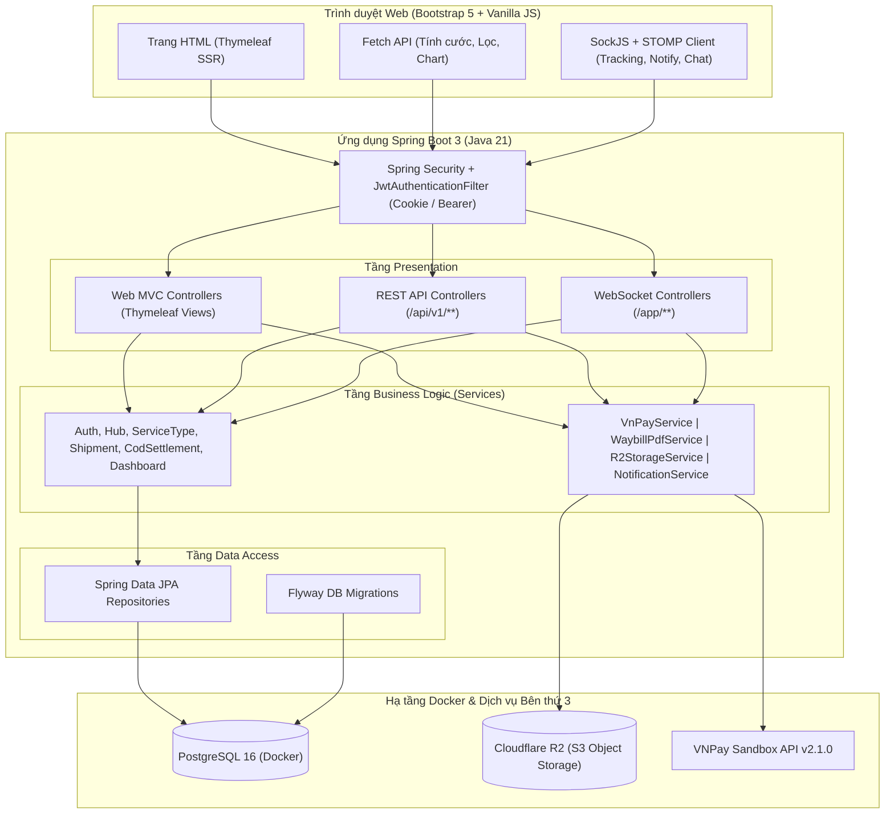

# Tài liệu Kiến trúc Hệ thống (System Architecture)
## Dự án: Hệ thống Quản lý Chuỗi Giao nhận Logistic — UTEExpress

---

## 1. Tổng quan Kiến trúc (High-Level Architecture)

UTEExpress áp dụng kiến trúc **Layered Monolith chuẩn Spring Boot** (*Controller → Service → Repository → Database*): gọn gàng, dễ triển khai, dễ debug và phù hợp trực tiếp với đồ án lập trình web (không dùng microservices, message broker ngoài hay tầng trừu tượng thừa).



---

## 2. Tech Stack & Thư viện Chính

| Thành phần | Công nghệ / Thư viện | Lý do chọn (thực dụng, ổn định) |
| :--- | :--- | :--- |
| **Runtime & Build** | Java 21 LTS, Maven 3.9+ | Khớp môi trường máy hiện tại, hỗ trợ cú pháp Java hiện đại (`record`, `switch` expression). |
| **Framework Backend** | Spring Boot `3.4.x` | Ổn định trên Java 21, hệ sinh thái chuẩn. |
| **View & Giao diện** | Thymeleaf + `thymeleaf-layout-dialect` + Bootstrap 5.3 + Bootstrap Icons + Chart.js | Chia layout header/sidebar sạch sẽ, responsive sẵn, không cần build tool frontend (Node/Webpack). |
| **Database & Migration** | PostgreSQL 16 (Docker), Spring Data JPA, Flyway (`flyway-database-postgresql`) | Quản lý schema & dữ liệu mẫu bằng file SQL có version rõ ràng, tránh lỗi `ddl-auto=update`. |
| **Bảo mật & JWT** | Spring Security 6, `jjwt` (`0.12.x`) | Xác thực stateless bằng JWT ký `HS256` lưu trong `HttpOnly Cookie`. |
| **Realtime** | Spring WebSocket (`STOMP` + `SockJS` + Simple In-Memory Broker) | Tích hợp sẵn trong Spring Boot, không cần cài RabbitMQ/Redis. |
| **Object Storage (Ảnh POD)** | **Cloudflare R2** + AWS SDK v2 (`software.amazon.awssdk:s3`) | Tương thích chuẩn S3 API, miễn phí egress, triển khai gọn chỉ với 1 `S3Client` cấu hình `endpointOverride`. |
| **In Tem PDF & Mã vạch** | **OpenPDF** (`com.github.librepdf:openpdf`) + **ZXing** (`core`, `javase`) | Nhẹ, mã nguồn mở miễn phí (LGPL/MPL), sinh trực tiếp PDF A6/A5 kèm Barcode Code128 và QR Code. |
| **Thanh toán Online** | VNPay Sandbox (HTTP redirect + HMAC-SHA512 thuần Java) | Không cần SDK nặng, dễ kiểm soát chữ ký và debug. |
| **Tiện ích** | Lombok, Spring Validation (`jakarta.validation`) | Giảm code boilerplate, validate DTO/form gọn gàng. |

---

## 3. Kiến trúc Bảo mật: Spring Security + JWT + Thymeleaf

Để JWT hoạt động thật sự xuyên suốt trên cả **Thymeleaf (SSR)**, **REST API** và **WebSocket** mà không dùng `HttpSession`:

1. **Chế độ Stateless:** Cấu hình `SessionCreationPolicy.STATELESS`.
2. **Phát hành Token khi đăng nhập (`POST /auth/login`):**
   * Xác thực email + mật khẩu (BCrypt) và kiểm tra `status == ACTIVE`.
   * Sinh JWT Access Token (hạn `24 giờ`, ký `HS256` từ `JWT_SECRET` trong `.env`) chứa claims: `sub` (email), `uid` (userId), `role`, `hubId`.
   * Gửi về trình duyệt qua **Cookie `ACCESS_TOKEN`** với thuộc tính `HttpOnly=true`, `Path=/`, `SameSite=Lax`, `Max-Age=86400`.
3. **Bộ lọc `JwtAuthenticationFilter` (`OncePerRequestFilter`):**
   * Chạy trước `UsernamePasswordAuthenticationFilter`.
   * Trích xuất token theo thứ tự ưu tiên: *(1) Cookie `ACCESS_TOKEN`* → *(2) Header `Authorization: Bearer <token>`* (thuận tiện khi test API bằng Postman/Swagger).
   * Nếu hợp lệ → tải `CustomUserDetails` (chứa `id`, `email`, `fullName`, `role`, `hubId`) vào `SecurityContextHolder`. Nhờ đó các thẻ Thymeleaf (`sec:authorize`, `sec:authentication`) chạy mượt không cần session.
4. **Phân quyền URL & Tầng Service:**
   * **URL rules:**
     * Public: `/`, `/tracking/**`, `/estimate/**`, `/hubs/**`, `/auth/**`, `/payment/vnpay-return`, `/api/v1/public/**`, `/api/v1/payment/vnpay-ipn`, `/css/**`, `/js/**`, `/images/**`, `/ws/**`.
     * Theo vai trò: `/customer/**` (`CUSTOMER`), `/staff/**` (`STAFF`, `ADMIN`), `/shipper/**` (`SHIPPER`), `/admin/**` (`ADMIN`).
   * **Kiểm tra dữ liệu (chống IDOR) ở Service:** xác nhận chủ đơn (`customer_id`), bưu cục liên quan (`hub_id`), hoặc shipper được phân công trước khi cho xem/sửa.
5. **Xử lý lỗi xác thực tách biệt Web & API:**
   * Request tới `/api/**` khi chưa đăng nhập / thiếu quyền → trả JSON `401` / `403`.
   * Request trang web Thymeleaf → `401` redirect sang `/auth/login`, `403` render trang `templates/error/403.html`.
6. **Cấu hình CSRF:** Tắt CSRF (`csrf.disable()`) do hệ thống hoàn toàn stateless kết hợp `SameSite=Lax` trên cookie JWT, giúp đồng nhất thao tác giữa form Thymeleaf, Fetch API, WebSocket và VNPay callback.

---

## 4. Kiến trúc Realtime WebSocket (STOMP + SockJS)

* **Endpoint kết nối:** `/ws` (bật `.withSockJS()`).
* **Broker tích hợp:** `config.enableSimpleBroker("/topic", "/queue")` và `config.setApplicationDestinationPrefixes("/app")`, `config.setUserDestinationPrefix("/user")`.
* **Xác thực kết nối WebSocket:**
  * Trình duyệt tự động đính kèm Cookie `ACCESS_TOKEN` trong HTTP Handshake tới `/ws`.
  * `JwtAuthenticationFilter` đã thiết lập `Principal` (email người dùng) sẵn cho phiên WebSocket → `SimpMessagingTemplate.convertAndSendToUser(email, "/queue/notifications", dto)` hoạt động ngay mà không cần code handshake phức tạp.
  * Trang tra cứu công khai (`/tracking`) vẫn kết nối được tới `/ws` với quyền ẩn danh chỉ để **subscribe** `/topic/tracking/{trackingCode}` (chỉ đọc, không gửi được tin nhắn).
* **Quy ước các kênh (Destinations):**

| Kênh (Destination) | Loại | Quyền truy cập | Mục đích |
| :--- | :--- | :--- | :--- |
| `/topic/tracking/{trackingCode}` | Subscribe | Public & Đã đăng nhập | Nhận cập nhật trạng thái & tracking log realtime (dữ liệu đã che thông tin nhạy cảm). |
| `/user/queue/notifications` | Subscribe | Đã đăng nhập | Nhận thông báo cá nhân (đơn mới, phân công shipper, giao hàng, đối soát COD). |
| `/topic/chat/{shipmentId}` | Subscribe | Chủ đơn / Staff hub liên quan / Admin | Nhận tin nhắn chat CSKH realtime theo vận đơn. |
| `/app/chat/{shipmentId}` | Send | Chủ đơn / Staff hub liên quan / Admin | Gửi tin nhắn mới → lưu `chat_messages` → broadcast ra `/topic/chat/{shipmentId}`. |

*Kiểm tra quyền đọc/gửi phòng chat thực hiện tại `ChannelInterceptor` (khi `SUBSCRIBE`) và trong `ChatController` (khi nhận `@MessageMapping`).*

---

## 5. Thiết kế Các Module Tích hợp

### 5.1. Thanh toán VNPay Sandbox (`VnPayService`)
* Cấu hình qua biến môi trường: `VNPAY_TMN_CODE`, `VNPAY_HASH_SECRET`, `VNPAY_PAY_URL`, `VNPAY_RETURN_URL`.
* Tạo URL thanh toán chuẩn VNPay v2.1.0: sắp xếp tham số theo bảng chữ cái, encode URL chuẩn, ký `HMAC-SHA512` bằng `VNPAY_HASH_SECRET`.
* Hàm xử lý kết quả dùng chung cho cả **Return URL** (`GET /payment/vnpay-return`) và **IPN** (`GET /api/v1/payment/vnpay-ipn`):
  1. Xác thực chữ ký `vnp_SecureHash`.
  2. Tìm vận đơn theo `vnp_TxnRef` và đối chiếu số tiền (`vnp_Amount / 100`).
  3. Kiểm tra **idempotent**: nếu đơn đã là `PAID` thì không cập nhật lại.
  4. Nếu `vnp_ResponseCode == "00"` → cập nhật `paymentStatus = PAID`, `status = CREATED`, lưu `vnpTransactionNo`, ghi `shipment_tracking_logs`, bắn thông báo WebSocket tới Staff bưu cục gửi.

### 5.2. Xuất Tem Vận đơn PDF (`WaybillPdfService`)
* Dùng **ZXing** tạo 2 ảnh PNG trực tiếp trong RAM (`ByteArrayOutputStream`):
  * **Barcode 1D (`CODE_128`):** mã hóa chuỗi `trackingCode`.
  * **QR Code (`QR_CODE`):** mã hóa URL `{app.base-url}/tracking?codes={trackingCode}`.
* Dùng **OpenPDF** dựng bố cục bảng tem chuẩn khổ `A6` (`PageSize.A6`, hỗ trợ `?size=A5` → `PageSize.A5`).
* Nhúng font TrueType hỗ trợ tiếng Việt đầy đủ (VD: `src/main/resources/fonts/DejaVuSans.ttf` và `DejaVuSans-Bold.ttf`) để hiển thị dấu tiếng Việt chính xác 100%, không lỗi chữ.

### 5.3. Lưu trữ & Bảo vệ Ảnh POD trên Cloudflare R2 (`R2StorageService`)
* Kết nối tới **Cloudflare R2** bằng AWS SDK v2 (`S3Client` cấu hình `endpointOverride = R2_ENDPOINT`, `region = "auto"`, `pathStyleAccessEnabled = true`).
* Bucket R2 đặt ở chế độ **Private** (không mở public trực tiếp).
* Khi Shipper upload ảnh:
  1. Kiểm tra file không rỗng, dung lượng `<= 5MB`.
  2. Kiểm tra MIME type hợp lệ (`image/jpeg`, `image/png`, `image/webp`) và phần mở rộng khớp.
  3. Upload trực tiếp lên bucket R2 với object key dạng `pod/{UUID}.{ext}` (loại bỏ tên file gốc) và lưu `pod_image_key` vào PostgreSQL.
* **Phục vụ ảnh có kiểm tra quyền:** qua `GET /files/pod/{shipmentId}` kiểm tra người gọi phải là Chủ đơn, Shipper giao đơn, Staff hub liên quan hoặc Admin → đọc stream từ R2 (`S3Client.getObject`) trả về trình duyệt kèm đúng `Content-Type`.

---

## 6. Cấu trúc Thư mục Source Code

Cấu trúc package rõ ràng, dễ tìm file, tránh chia tách thừa:

```text
src/
├── main/
│   ├── java/com/uteexpress/
│   │   ├── UteExpressApplication.java
│   │   ├── config/               # SecurityConfig, WebSocketConfig, AppProperties, VnPayConfig, R2Config
│   │   ├── security/             # JwtTokenProvider, JwtAuthenticationFilter, CustomUserDetails, CustomUserDetailsService
│   │   ├── enums/                # Role, UserStatus, HubType, ShipmentStatus, PaymentStatus, CodStatus, PayerType, PaymentMethod, InspectionPolicy, SettlementStatus
│   │   ├── entity/               # User, Hub, ServiceType, CustomerAddress, Shipment, ShipmentTrackingLog, CodSettlement, Notification, ChatMessage
│   │   ├── repository/           # Spring Data JPA Repositories
│   │   ├── dto/                  # Request/Response DTOs (dùng Java record/class gọn nhẹ)
│   │   ├── service/              # AuthService, HubService, PricingService, ShipmentService, VnPayService, WaybillPdfService, R2StorageService, CodSettlementService, NotificationService, ChatService, DashboardService
│   │   ├── controller/
│   │   │   ├── web/              # PublicController, AuthController, CustomerController, StaffController, ShipperController, AdminController, PaymentController, FileController
│   │   │   ├── api/              # PricingApiController, TrackingApiController, NotificationApiController, DashboardApiController, VnPayIpnController
│   │   │   └── ws/               # ChatWebSocketController
│   │   └── exception/            # BusinessException, ResourceNotFoundException, ApiExceptionHandler, WebExceptionHandler
│   └── resources/
│       ├── application.yml
│       ├── db/migration/         # V1__init_schema.sql, V2__seed_data.sql (Flyway)
│       ├── fonts/                # Font Unicode tiếng Việt cho OpenPDF
│       ├── static/
│       │   ├── css/              # app.css (custom nhẹ trên nền Bootstrap 5)
│       │   └── js/               # tracking-ws.js, notifications-ws.js, chat-ws.js, order-form.js
│       └── templates/
│           ├── layout/           # base-public.html, base-portal.html, fragments (navbar, sidebar, alerts)
│           ├── public/           # home.html, tracking.html, estimate.html, hubs.html
│           ├── auth/             # login.html, register.html
│           ├── customer/         # dashboard.html, shipment-create.html, shipment-list.html, shipment-detail.html, addresses.html, cod-list.html, profile.html
│           ├── staff/            # dashboard.html, shipment-list.html, shipment-detail.html, cod-collection.html
│           ├── shipper/          # tasks.html, cod-summary.html
│           ├── admin/            # dashboard.html, hubs.html, services.html, users.html, cod-settlements.html
│           └── error/            # 403.html, 404.html, 500.html
└── test/
    └── java/com/uteexpress/      # Unit test cho PricingService, ShipmentStateMachine, JwtTokenProvider
```

---

## 7. Xử lý Ngoại lệ (Exception Handling) & Cấu hình Môi trường

### 7.1. Xử lý lỗi tập trung
* Dùng 2 ngoại lệ nghiệp vụ gọn nhẹ: `BusinessException` (lỗi quy tắc nghiệp vụ, trạng thái không hợp lệ — `400`), `ResourceNotFoundException` (`404`), `AccessDeniedException` (`403`).
* `ApiExceptionHandler` (`@RestControllerAdvice(basePackages = "com.uteexpress.controller.api")`): trả về JSON thống nhất `{ "timestamp", "status", "error", "message", "fieldErrors" }`.
* `WebExceptionHandler` (`@ControllerAdvice(basePackages = "com.uteexpress.controller.web")`): hiển thị flash message trên form hoặc render trang lỗi `403/404/500`.

### 7.2. Hạ tầng Local (`docker-compose.yml` & `.env`)
* `docker-compose.yml` chạy **duy nhất 1 service gọn nhẹ**:
  * **`postgres`** (`postgres:16-alpine`, port `5432`, mount named volume `pgdata`, kèm `healthcheck` `pg_isready`).
* Toàn bộ thông số nhạy cảm (`POSTGRES_USER`, `POSTGRES_PASSWORD`, `POSTGRES_DB`, `JWT_SECRET`, `VNPAY_TMN_CODE`, `VNPAY_HASH_SECRET`, `R2_ENDPOINT`, `R2_ACCESS_KEY_ID`, `R2_SECRET_ACCESS_KEY`, `R2_BUCKET_NAME`) khai báo trong `.env` (không commit lên Git) và cung cấp mẫu trong `.env.example`.
* Ứng dụng Spring Boot chạy trực tiếp trên máy local bằng `mvn spring-boot:run` kết nối tới PostgreSQL trong Docker (thuận tiện hot-reload khi phát triển và debug).
