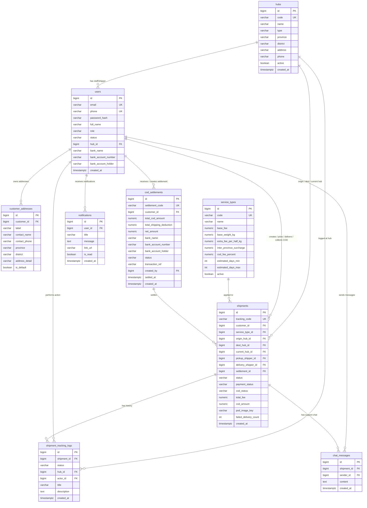

# Thiết kế Cơ sở Dữ liệu (Database Design & ERD)
## Dự án: Hệ thống Quản lý Chuỗi Giao nhận Logistic — UTEExpress

---

## 1. Quy ước Thiết kế (PostgreSQL 16)

* **Số lượng bảng:** `9 bảng` cốt lõi — vừa đủ phục vụ toàn bộ nghiệp vụ, không tách bảng thừa.
* **Khóa chính (PK):** Dùng `BIGSERIAL` (`Long` trong Java) gọn nhẹ, dễ tra cứu. Các mã nghiệp vụ hiển thị (`tracking_code`, `hub.code`, `settlement_code`) có ràng buộc `UNIQUE`.
* **Kiểu Enum:** Lưu dạng `VARCHAR` (kết hợp `@Enumerated(EnumType.STRING)` trong JPA) thay vì PostgreSQL `CREATE TYPE ENUM` để dễ cập nhật qua Flyway và tránh lỗi mapping.
* **Tiền tệ & Thời gian:** Tiền VNĐ dùng `NUMERIC(15, 0)` (`BigDecimal` trong Java, không sai số thập phân). Mốc thời gian dùng `TIMESTAMPTZ` (mặc định `NOW()`).
* **Quản lý Schema:** Dùng **Flyway** (`spring.jpa.hibernate.ddl-auto=validate`) để đảm bảo đồng nhất tuyệt đối giữa SQL và JPA Entity.

---

## 2. Sơ đồ Quan hệ Thực thể (ERD)



---

## 3. Đặc tả Chi tiết Các Bảng

### 3.1. `hubs` — Chuỗi bưu cục & kho trung chuyển
| Cột | Kiểu PostgreSQL | Ràng buộc | Mô tả |
| :--- | :--- | :--- | :--- |
| `id` | `BIGSERIAL` | `PK` | Khóa chính |
| `code` | `VARCHAR(20)` | `NOT NULL, UNIQUE` | Mã định tuyến bưu cục (VD: `HCM-TD01`, `HN-CG01`) |
| `name` | `VARCHAR(150)` | `NOT NULL` | Tên bưu cục / kho trung chuyển |
| `type` | `VARCHAR(20)` | `NOT NULL` | `POST_OFFICE` hoặc `SORTING_HUB` |
| `province` | `VARCHAR(100)` | `NOT NULL` | Tỉnh / Thành phố (dùng để định tuyến tự động) |
| `district` | `VARCHAR(100)` | `NOT NULL` | Quận / Huyện / TP trực thuộc |
| `address` | `VARCHAR(255)` | `NOT NULL` | Địa chỉ chi tiết |
| `phone` | `VARCHAR(20)` | `NOT NULL` | Số hotline bưu cục |
| `active` | `BOOLEAN` | `NOT NULL DEFAULT TRUE` | Trạng thái hoạt động (không xóa cứng) |
| `created_at` | `TIMESTAMPTZ` | `NOT NULL DEFAULT NOW()` | Thời điểm tạo |
| `updated_at` | `TIMESTAMPTZ` | `NOT NULL DEFAULT NOW()` | Thời điểm cập nhật |

### 3.2. `users` — Người dùng hệ thống
| Cột | Kiểu PostgreSQL | Ràng buộc | Mô tả |
| :--- | :--- | :--- | :--- |
| `id` | `BIGSERIAL` | `PK` | Khóa chính |
| `email` | `VARCHAR(150)` | `NOT NULL, UNIQUE` | Email đăng nhập |
| `phone` | `VARCHAR(20)` | `NOT NULL, UNIQUE` | Số điện thoại |
| `password_hash` | `VARCHAR(255)` | `NOT NULL` | Mật khẩu mã hóa BCrypt |
| `full_name` | `VARCHAR(120)` | `NOT NULL` | Họ và tên / Tên shop |
| `role` | `VARCHAR(20)` | `NOT NULL` | `CUSTOMER`, `STAFF`, `SHIPPER`, `ADMIN` |
| `status` | `VARCHAR(20)` | `NOT NULL DEFAULT 'ACTIVE'` | `ACTIVE` hoặc `LOCKED` |
| `hub_id` | `BIGINT` | `FK → hubs(id), NULL` | Bắt buộc với `STAFF`/`SHIPPER`; `NULL` với `CUSTOMER`/`ADMIN` |
| `bank_name` | `VARCHAR(100)` | `NULL` | Tên ngân hàng nhận tiền COD (dành cho `CUSTOMER`) |
| `bank_account_number` | `VARCHAR(50)` | `NULL` | Số tài khoản ngân hàng nhận COD |
| `bank_account_holder` | `VARCHAR(120)` | `NULL` | Tên chủ tài khoản ngân hàng |
| `created_at` | `TIMESTAMPTZ` | `NOT NULL DEFAULT NOW()` | Thời điểm tạo |
| `updated_at` | `TIMESTAMPTZ` | `NOT NULL DEFAULT NOW()` | Thời điểm cập nhật |

### 3.3. `service_types` — Gói dịch vụ & Bảng giá cước
| Cột | Kiểu PostgreSQL | Ràng buộc | Mô tả |
| :--- | :--- | :--- | :--- |
| `id` | `BIGSERIAL` | `PK` | Khóa chính |
| `code` | `VARCHAR(30)` | `NOT NULL, UNIQUE` | Mã gói (`STANDARD`, `EXPRESS`, `SAMEDAY`) |
| `name` | `VARCHAR(100)` | `NOT NULL` | Tên gói dịch vụ hiển thị |
| `description` | `VARCHAR(255)` | `NULL` | Mô tả ngắn |
| `base_fee` | `NUMERIC(15,0)` | `NOT NULL` | Cước cơ bản (VNĐ) cho trọng lượng chuẩn |
| `base_weight_kg` | `NUMERIC(6,2)` | `NOT NULL DEFAULT 1.00` | Ngưỡng trọng lượng chuẩn (kg) |
| `extra_fee_per_half_kg` | `NUMERIC(15,0)` | `NOT NULL` | Đơn giá cho mỗi `0.5 kg` vượt ngưỡng (VNĐ) |
| `inter_province_surcharge` | `NUMERIC(15,0)` | `NOT NULL DEFAULT 0` | Phụ phí liên tỉnh (VNĐ) |
| `cod_fee_percent` | `NUMERIC(5,2)` | `NOT NULL DEFAULT 0.00` | Phần trăm phí thu hộ COD (VD: `1.00` = 1%) |
| `estimated_days_min` | `INT` | `NOT NULL` | Số ngày giao tối thiểu dự kiến |
| `estimated_days_max` | `INT` | `NOT NULL` | Số ngày giao tối đa dự kiến |
| `active` | `BOOLEAN` | `NOT NULL DEFAULT TRUE` | Gói đang mở sử dụng |
| `created_at` | `TIMESTAMPTZ` | `NOT NULL DEFAULT NOW()` | Thời điểm tạo |
| `updated_at` | `TIMESTAMPTZ` | `NOT NULL DEFAULT NOW()` | Thời điểm cập nhật |

### 3.4. `customer_addresses` — Sổ địa chỉ của Khách hàng
| Cột | Kiểu PostgreSQL | Ràng buộc | Mô tả |
| :--- | :--- | :--- | :--- |
| `id` | `BIGSERIAL` | `PK` | Khóa chính |
| `customer_id` | `BIGINT` | `NOT NULL, FK → users(id) ON DELETE CASCADE` | Chủ sổ địa chỉ |
| `label` | `VARCHAR(80)` | `NOT NULL` | Nhãn gợi nhớ (VD: "Kho Thủ Đức", "Cửa hàng Q1") |
| `contact_name` | `VARCHAR(120)` | `NOT NULL` | Tên người liên hệ |
| `contact_phone` | `VARCHAR(20)` | `NOT NULL` | SĐT liên hệ |
| `province` | `VARCHAR(100)` | `NOT NULL` | Tỉnh / Thành phố |
| `district` | `VARCHAR(100)` | `NOT NULL` | Quận / Huyện |
| `address_detail` | `VARCHAR(255)` | `NOT NULL` | Số nhà, đường, phường/xã |
| `is_default` | `BOOLEAN` | `NOT NULL DEFAULT FALSE` | Địa chỉ lấy hàng mặc định |
| `created_at` | `TIMESTAMPTZ` | `NOT NULL DEFAULT NOW()` | Thời điểm tạo |

### 3.5. `cod_settlements` — Phiếu đối soát & thanh toán COD
| Cột | Kiểu PostgreSQL | Ràng buộc | Mô tả |
| :--- | :--- | :--- | :--- |
| `id` | `BIGSERIAL` | `PK` | Khóa chính |
| `settlement_code` | `VARCHAR(30)` | `NOT NULL, UNIQUE` | Mã phiếu đối soát (VD: `COD2611200001`) |
| `customer_id` | `BIGINT` | `NOT NULL, FK → users(id)` | Khách hàng thụ hưởng |
| `total_cod_amount` | `NUMERIC(15,0)` | `NOT NULL` | Tổng tiền COD thu hộ từ các đơn |
| `total_shipping_deduction` | `NUMERIC(15,0)` | `NOT NULL DEFAULT 0` | Tổng cước phí cấn trừ (đơn người gửi trả chưa thanh toán) |
| `net_amount` | `NUMERIC(15,0)` | `NOT NULL` | Số tiền thực chuyển (`total_cod_amount - total_shipping_deduction`) |
| `bank_name` | `VARCHAR(100)` | `NULL` | Snapshot tên ngân hàng lúc lập phiếu |
| `bank_account_number` | `VARCHAR(50)` | `NULL` | Snapshot số tài khoản lúc lập phiếu |
| `bank_account_holder` | `VARCHAR(120)` | `NULL` | Snapshot tên chủ tài khoản lúc lập phiếu |
| `status` | `VARCHAR(20)` | `NOT NULL DEFAULT 'PENDING'` | `PENDING` hoặc `SETTLED` |
| `transaction_ref` | `VARCHAR(100)` | `NULL` | Mã giao dịch chuyển khoản tham chiếu |
| `note` | `TEXT` | `NULL` | Ghi chú đối soát |
| `created_by` | `BIGINT` | `NOT NULL, FK → users(id)` | Admin lập phiếu |
| `settled_at` | `TIMESTAMPTZ` | `NULL` | Thời điểm xác nhận đã chuyển khoản |
| `created_at` | `TIMESTAMPTZ` | `NOT NULL DEFAULT NOW()` | Thời điểm tạo phiếu |

### 3.6. `shipments` — Vận đơn (Bảng trung tâm)
| Cột | Kiểu PostgreSQL | Ràng buộc | Mô tả |
| :--- | :--- | :--- | :--- |
| `id` | `BIGSERIAL` | `PK` | Khóa chính |
| `tracking_code` | `VARCHAR(30)` | `NOT NULL, UNIQUE` | Mã vận đơn (`UTE` + `YYMMDD` + 6 ký tự) |
| `customer_id` | `BIGINT` | `NOT NULL, FK → users(id)` | Khách hàng tạo đơn |
| `service_type_id` | `BIGINT` | `NOT NULL, FK → service_types(id)` | Gói dịch vụ áp dụng |
| `sender_name` | `VARCHAR(120)` | `NOT NULL` | Tên người gửi |
| `sender_phone` | `VARCHAR(20)` | `NOT NULL` | SĐT người gửi |
| `sender_province` | `VARCHAR(100)` | `NOT NULL` | Tỉnh/Thành gửi |
| `sender_district` | `VARCHAR(100)` | `NOT NULL` | Quận/Huyện gửi |
| `sender_address` | `VARCHAR(255)` | `NOT NULL` | Địa chỉ chi tiết người gửi |
| `receiver_name` | `VARCHAR(120)` | `NOT NULL` | Tên người nhận |
| `receiver_phone` | `VARCHAR(20)` | `NOT NULL` | SĐT người nhận |
| `receiver_province` | `VARCHAR(100)` | `NOT NULL` | Tỉnh/Thành nhận |
| `receiver_district` | `VARCHAR(100)` | `NOT NULL` | Quận/Huyện nhận |
| `receiver_address` | `VARCHAR(255)` | `NOT NULL` | Địa chỉ chi tiết người nhận |
| `origin_hub_id` | `BIGINT` | `NOT NULL, FK → hubs(id)` | Bưu cục gửi |
| `dest_hub_id` | `BIGINT` | `NOT NULL, FK → hubs(id)` | Bưu cục nhận |
| `current_hub_id` | `BIGINT` | `NOT NULL, FK → hubs(id)` | Bưu cục hiện tại đang quản lý đơn |
| `pickup_shipper_id` | `BIGINT` | `NULL, FK → users(id)` | Shipper được phân công lấy hàng |
| `delivery_shipper_id` | `BIGINT` | `NULL, FK → users(id)` | Shipper được phân công giao hàng |
| `item_name` | `VARCHAR(200)` | `NOT NULL` | Tên hàng hóa |
| `actual_weight_kg` | `NUMERIC(8,2)` | `NOT NULL` | Trọng lượng thực (kg) |
| `length_cm` | `INT` | `NULL` | Chiều dài (cm — tùy chọn) |
| `width_cm` | `INT` | `NULL` | Chiều rộng (cm — tùy chọn) |
| `height_cm` | `INT` | `NULL` | Chiều cao (cm — tùy chọn) |
| `chargeable_weight_kg` | `NUMERIC(8,2)` | `NOT NULL` | Trọng lượng tính cước sau quy đổi & làm tròn `0.5 kg` |
| `is_fragile` | `BOOLEAN` | `NOT NULL DEFAULT FALSE` | Cờ hàng dễ vỡ (in lên tem PDF) |
| `inspection_policy` | `VARCHAR(30)` | `NOT NULL DEFAULT 'ALLOW_VIEW_NO_TRY'` | `ALLOW_VIEW_NO_TRY`, `ALLOW_TRY`, `NO_VIEW` |
| `note` | `TEXT` | `NULL` | Ghi chú giao hàng |
| `shipping_fee` | `NUMERIC(15,0)` | `NOT NULL` | Cước vận chuyển (đã gồm phụ phí vượt cân & liên tỉnh) |
| `cod_fee` | `NUMERIC(15,0)` | `NOT NULL DEFAULT 0` | Phí dịch vụ thu hộ COD |
| `total_fee` | `NUMERIC(15,0)` | `NOT NULL` | Tổng cước (`shipping_fee + cod_fee`) |
| `cod_amount` | `NUMERIC(15,0)` | `NOT NULL DEFAULT 0` | Tiền hàng cần thu hộ người nhận (VNĐ) |
| `payer_type` | `VARCHAR(20)` | `NOT NULL` | `SENDER` hoặc `RECEIVER` |
| `payment_method` | `VARCHAR(20)` | `NOT NULL` | `CASH` hoặc `VNPAY` |
| `payment_status` | `VARCHAR(20)` | `NOT NULL DEFAULT 'UNPAID'` | `UNPAID`, `PAID`, `REFUND_PENDING`, `REFUNDED` |
| `vnp_txn_ref` | `VARCHAR(64)` | `NULL, UNIQUE` | Mã tham chiếu giao dịch gửi sang VNPay |
| `vnp_transaction_no` | `VARCHAR(64)` | `NULL` | Mã giao dịch trả về từ VNPay |
| `paid_at` | `TIMESTAMPTZ` | `NULL` | Thời điểm thanh toán cước thành công |
| `status` | `VARCHAR(30)` | `NOT NULL` | Trạng thái vận đơn (theo State Machine SRS) |
| `failed_delivery_count` | `INT` | `NOT NULL DEFAULT 0` | Số lần giao thất bại (tối đa `3`) |
| `pod_image_key` | `VARCHAR(255)` | `NULL` | Object key ảnh POD trên **Cloudflare R2** (`pod/{uuid}.jpg`) |
| `delivered_at` | `TIMESTAMPTZ` | `NULL` | Thời điểm giao thành công |
| `cod_status` | `VARCHAR(25)` | `NOT NULL DEFAULT 'NONE'` | `NONE`, `PENDING`, `HELD_BY_SHIPPER`, `COLLECTED_BY_HUB`, `SETTLED` |
| `cod_collected_by` | `BIGINT` | `NULL, FK → users(id)` | Staff bưu cục đã xác nhận nhận COD từ Shipper |
| `cod_collected_at` | `TIMESTAMPTZ` | `NULL` | Thời điểm Shipper nộp COD về bưu cục |
| `settlement_id` | `BIGINT` | `NULL, FK → cod_settlements(id)` | Thuộc phiếu đối soát COD nào |
| `created_at` | `TIMESTAMPTZ` | `NOT NULL DEFAULT NOW()` | Thời điểm tạo đơn |
| `updated_at` | `TIMESTAMPTZ` | `NOT NULL DEFAULT NOW()` | Thời điểm cập nhật gần nhất |

### 3.7. `shipment_tracking_logs` — Lịch sử hành trình vận đơn
| Cột | Kiểu PostgreSQL | Ràng buộc | Mô tả |
| :--- | :--- | :--- | :--- |
| `id` | `BIGSERIAL` | `PK` | Khóa chính |
| `shipment_id` | `BIGINT` | `NOT NULL, FK → shipments(id) ON DELETE CASCADE` | Vận đơn |
| `status` | `VARCHAR(30)` | `NOT NULL` | Trạng thái tại mốc sự kiện |
| `hub_id` | `BIGINT` | `NULL, FK → hubs(id)` | Bưu cục diễn ra sự kiện (nếu có) |
| `actor_id` | `BIGINT` | `NULL, FK → users(id)` | Người thao tác (`NULL` nếu do VNPay callback) |
| `title` | `VARCHAR(150)` | `NOT NULL` | Tiêu đề ngắn (VD: "Đã nhập kho Bưu cục Thủ Đức") |
| `description` | `TEXT` | `NULL` | Ghi chú chi tiết / lý do giao thất bại |
| `created_at` | `TIMESTAMPTZ` | `NOT NULL DEFAULT NOW()` | Thời điểm ghi nhận |

### 3.8. `notifications` — Thông báo đẩy WebSocket
| Cột | Kiểu PostgreSQL | Ràng buộc | Mô tả |
| :--- | :--- | :--- | :--- |
| `id` | `BIGSERIAL` | `PK` | Khóa chính |
| `user_id` | `BIGINT` | `NOT NULL, FK → users(id) ON DELETE CASCADE` | Người nhận thông báo |
| `title` | `VARCHAR(150)` | `NOT NULL` | Tiêu đề thông báo |
| `message` | `TEXT` | `NOT NULL` | Nội dung ngắn gọn |
| `link_url` | `VARCHAR(255)` | `NULL` | Đường dẫn mở nhanh khi click (VD: `/customer/shipments/12`) |
| `is_read` | `BOOLEAN` | `NOT NULL DEFAULT FALSE` | Đã đọc hay chưa |
| `created_at` | `TIMESTAMPTZ` | `NOT NULL DEFAULT NOW()` | Thời điểm tạo |

### 3.9. `chat_messages` — Lịch sử chat CSKH theo vận đơn
| Cột | Kiểu PostgreSQL | Ràng buộc | Mô tả |
| :--- | :--- | :--- | :--- |
| `id` | `BIGSERIAL` | `PK` | Khóa chính |
| `shipment_id` | `BIGINT` | `NOT NULL, FK → shipments(id) ON DELETE CASCADE` | Phòng chat gắn theo vận đơn |
| `sender_id` | `BIGINT` | `NOT NULL, FK → users(id)` | Người gửi tin nhắn |
| `content` | `TEXT` | `NOT NULL` | Nội dung tin nhắn |
| `created_at` | `TIMESTAMPTZ` | `NOT NULL DEFAULT NOW()` | Thời điểm gửi |

---

## 4. Chiến lược Chỉ mục (Indexes)

Chỉ tạo các index thiết yếu cho các truy vấn thường xuyên (lọc đơn theo vai trò, tra cứu, thông báo, biểu đồ):

```sql
CREATE INDEX idx_users_hub_role ON users(hub_id, role);
CREATE INDEX idx_shipments_customer_created ON shipments(customer_id, created_at DESC);
CREATE INDEX idx_shipments_status ON shipments(status);
CREATE INDEX idx_shipments_origin_hub ON shipments(origin_hub_id, status);
CREATE INDEX idx_shipments_dest_hub ON shipments(dest_hub_id, status);
CREATE INDEX idx_shipments_pickup_shipper ON shipments(pickup_shipper_id, status);
CREATE INDEX idx_shipments_delivery_shipper ON shipments(delivery_shipper_id, status);
CREATE INDEX idx_shipments_cod_status ON shipments(cod_status, customer_id);
CREATE INDEX idx_shipments_created_at ON shipments(created_at);
CREATE INDEX idx_tracking_logs_shipment ON shipment_tracking_logs(shipment_id, created_at DESC);
CREATE INDEX idx_notifications_user_read ON notifications(user_id, is_read, created_at DESC);
CREATE INDEX idx_chat_messages_shipment ON chat_messages(shipment_id, created_at ASC);
```

*(Các cột `UNIQUE` như `shipments.tracking_code`, `users.email`, `hubs.code`, `cod_settlements.settlement_code` tự động có B-Tree index trong PostgreSQL).*

---

## 5. Chiến lược Flyway Migration & Dữ liệu Mẫu (Seed Data)

Thư mục `src/main/resources/db/migration/` gồm 2 file gọn gàng:

1. **`V1__init_schema.sql`:** Khởi tạo đủ 9 bảng, khóa ngoại và 12 index ở trên.
2. **`V2__seed_data.sql`:** Dữ liệu mẫu sẵn dùng ngay để test/demo toàn bộ luồng nội vùng và liên tỉnh:
   * **6 Bưu cục / Kho trung chuyển trong chuỗi UTEExpress:**
     * `HCM-TD01` — Bưu cục Thủ Đức (TP. Hồ Chí Minh, `POST_OFFICE`)
     * `HCM-Q101` — Kho Trung chuyển Miền Nam (TP. Hồ Chí Minh, `SORTING_HUB`)
     * `BD-TDM01` — Bưu cục Thủ Dầu Một (Bình Dương, `POST_OFFICE`)
     * `DN-BH01` — Bưu cục Biên Hòa (Đồng Nai, `POST_OFFICE`)
     * `DNG-HC01` — Kho Trung chuyển Miền Trung (Đà Nẵng, `SORTING_HUB`)
     * `HN-CG01` — Bưu cục Cầu Giấy (Hà Nội, `POST_OFFICE`)
   * **3 Gói dịch vụ:**
     * `STANDARD` (*Tiêu chuẩn*): Cước cơ bản `20.000 VNĐ` (≤ 1kg), vượt cân `+5.000 VNĐ/0.5kg`, liên tỉnh `+10.000 VNĐ`, phí COD `1%`, `3–5 ngày`.
     * `EXPRESS` (*Nhanh*): Cước cơ bản `30.000 VNĐ` (≤ 1kg), vượt cân `+7.000 VNĐ/0.5kg`, liên tỉnh `+15.000 VNĐ`, phí COD `1%`, `1–2 ngày`.
     * `SAMEDAY` (*Hỏa tốc*): Cước cơ bản `50.000 VNĐ` (≤ 1kg), vượt cân `+10.000 VNĐ/0.5kg`, liên tỉnh `+30.000 VNĐ`, phí COD `1.5%`, `0–1 ngày`.
   * **Tài khoản demo mặc định (mật khẩu chung `123456` đã mã hóa BCrypt):**
     * `admin@uteexpress.vn` (`ADMIN`)
     * `staff.hcm@uteexpress.vn` (`STAFF` — `HCM-TD01`), `staff.hn@uteexpress.vn` (`STAFF` — `HN-CG01`)
     * `shipper.hcm@uteexpress.vn` (`SHIPPER` — `HCM-TD01`), `shipper.hn@uteexpress.vn` (`SHIPPER` — `HN-CG01`)
     * `shop@uteexpress.vn` (`CUSTOMER` — có sẵn sổ địa chỉ mẫu & tài khoản ngân hàng nhận COD)
   * **Vận đơn mẫu:** 4–5 vận đơn mẫu ở các trạng thái khác nhau (`CREATED`, `IN_TRANSIT`, `OUT_FOR_DELIVERY`, `DELIVERED`) kèm lịch sử hành trình để vừa mở trang lên là có sẵn dữ liệu demo tra cứu và biểu đồ Dashboard.
