# Đặc tả Giao diện & Trải nghiệm Người dùng (UI/UX Spec)
## Dự án: Hệ thống Quản lý Chuỗi Giao nhận Logistic — UTEExpress

---

## 1. Phong cách Thiết kế & Design System (Bootstrap 5.3)

UTEExpress sử dụng **Bootstrap 5.3 + Bootstrap Icons + 1 file CSS tùy biến nhẹ (`static/css/app.css`)** — không cần build tool frontend, đảm bảo sạch sẽ, dễ đọc số liệu vận đơn và responsive tốt trên trình duyệt web.

### 1.1. Bảng màu (Color Tokens)
* **Primary Brand (Xanh Navy UTE):** `#0D47A1` (Hover: `#09357A`) — dùng cho thanh điều hướng, sidebar, tiêu đề và hành động chính.
* **Accent Logistic (Cam Express — cảm hứng GHN/SPX):** `#F97316` (Hover: `#EA580C`) — dùng cho nút CTA nổi bật (*Tra cứu ngay*, *Tạo vận đơn mới*) và số tiền cần thu.
* **Nền & Bề mặt:** Nền trang `#F4F6F9`, Card `#FFFFFF`, viền nhẹ `#E5E7EB`, bo góc `10px`.
* **Chữ (Typography):**
  * Font chính: **`Inter`** (Google Fonts, hỗ trợ đầy đủ tiếng Việt).
  * Font mã vận đơn / Routing Code / Số tiền lớn: **`JetBrains Mono`** hoặc `font-monospace` để phân biệt rõ số `0` và chữ `O`.

### 1.2. Quy ước Màu Badge Trạng thái Vận đơn (Đồng nhất toàn hệ thống)
| Nhóm trạng thái | Màu Bootstrap | Nhãn hiển thị tiếng Việt |
| :--- | :--- | :--- |
| `PENDING_PAYMENT` | `bg-warning-subtle text-warning-emphasis` | Chờ thanh toán |
| `CREATED`, `ASSIGNED_PICKUP` | `bg-info-subtle text-info-emphasis` | Chờ lấy hàng / Đã phân công lấy |
| `PICKED_UP`, `IN_ORIGIN_HUB`, `IN_TRANSIT`, `IN_DEST_HUB` | `bg-primary-subtle text-primary` | Đã lấy / Tại kho gửi / Đang trung chuyển / Tại kho nhận |
| `OUT_FOR_DELIVERY` | Custom cam (`#FFF7ED` nền, `#C2410C` chữ) | Đang giao hàng |
| `DELIVERED` | `bg-success-subtle text-success` | Giao thành công |
| `DELIVERY_FAILED`, `RETURNING`, `RETURNED` | `bg-danger-subtle text-danger` | Giao thất bại / Đang hoàn / Đã hoàn hàng |
| `CANCELLED` | `bg-secondary-subtle text-secondary` | Đã hủy |

---

## 2. Kiến trúc Layout Thymeleaf (Chỉ 2 Layout dùng chung)

Sử dụng `thymeleaf-layout-dialect` để tái sử dụng hoàn toàn khung giao diện:

1. **`layout/base-public.html`** (Trang chủ, Tra cứu, Ước tính cước, Bưu cục, Đăng nhập/Đăng ký):
   * **Top Navbar:** Logo **UTEExpress** + Menu (`Trang chủ`, `Tra cứu vận đơn`, `Ước tính cước`, `Bưu cục`) + Cụm nút `Đăng nhập` / `Đăng ký` (nếu đã đăng nhập → hiện nút `Vào hệ thống`).
   * **Main Content:** Nội dung từng trang.
   * **Footer:** Thông tin liên hệ UTEExpress, hotline giả lập và liên kết nhanh.
2. **`layout/base-portal.html`** (Dùng chung cho cả 4 vai trò `CUSTOMER`, `STAFF`, `SHIPPER`, `ADMIN`):
   * **Left Sidebar (cố định trên desktop, tự thu vào Offcanvas trên màn hình nhỏ):** Tự động hiển thị nhóm menu đúng theo vai trò (`sec:authorize`), đánh dấu mục đang mở (`active`).
   * **Topbar:** Tiêu đề trang + **Biểu tượng Chuông Thông báo Realtime WebSocket** (badge đỏ đếm số chưa đọc + dropdown 10 thông báo mới nhất) + Thông tin user (`Họ tên`, badge `Role`, tên `Bưu cục` nếu là Staff/Shipper) + nút `Đăng xuất`.
   * **Toast Container (góc phải dưới):** Hiển thị popup thông báo WebSocket realtime và flash message (`success` / `error`).

---

## 3. Sitemap Hệ thống

```mermaid
flowchart TD
    Root["UTEExpress Web"]
    Root --> Pub["Cổng Công khai"]
    Root --> Auth["Đăng nhập / Đăng ký"]
    Root --> Cust["Cổng Khách hàng (/customer)"]
    Root --> Staff["Cổng Bưu cục (/staff)"]
    Root --> Ship["Cổng Shipper (/shipper)"]
    Root --> Adm["Cổng Quản trị (/admin)"]

    Pub --> P1["/ Trang chủ"]
    Pub --> P2["/tracking Tra cứu 1-5 đơn"]
    Pub --> P3["/estimate Ước tính cước"]
    Pub --> P4["/hubs Mạng lưới bưu cục"]

    Cust --> C1["Tổng quan & Tạo đơn mới"]
    Cust --> C2["Quản lý Vận đơn & Chi tiết (PDF, POD, Chat)"]
    Cust --> C3["Sổ địa chỉ & Hồ sơ Ngân hàng COD"]
    Cust --> C4["Lịch sử Đối soát COD"]

    Staff --> ST1["Tổng quan Bưu cục"]
    Staff --> ST2["Điều phối Vận đơn & Trung chuyển Hub"]
    Staff --> ST3["Thu tiền COD từ Shipper"]

    Ship --> SH1["Tác vụ: Cần lấy / Cần giao / Đã xong (+ Upload POD)"]
    Ship --> SH2["Tổng hợp tiền COD đang giữ"]

    Adm --> A1["Dashboard Thống kê (Chart.js)"]
    Adm --> A2["Quản lý Chuỗi Hub & Gói cước"]
    Adm --> A3["Quản lý Tài khoản"]
    Adm --> A4["Duyệt Đối soát COD"]
```



---

## 4. Thiết kế Bố cục Các Màn hình Trọng tâm

### 4.1. Trang chủ (`/`) & Tra cứu Vận đơn (`/tracking`) — Chuẩn Viettel Post
* **Hero Section (Trang chủ):** Nền gradient xanh navy, thanh nhập mã vận đơn lớn đặt giữa màn hình (placeholder: *"Nhập 1 hoặc tối đa 5 mã vận đơn, cách nhau bởi dấu phẩy..."*) kèm nút cam **"Tra cứu ngay"**; bên dưới là 3 thẻ giới thiệu gói cước (*Tiêu chuẩn / Nhanh / Hỏa tốc*) và nút sang trang Ước tính cước.
* **Trang kết quả Tra cứu (`/tracking`):**
  * Nếu nhập nhiều mã → hiển thị danh sách thẻ tóm tắt từng mã ở trên, bấm vào mã nào sẽ mở chi tiết bên dưới.
  * **Thanh tiến độ ngang 5 bước (Stepper):** `Đã tạo` → `Đã lấy hàng` → `Trung chuyển` → `Đang giao` → `Hoàn thành`.
  * **Thông tin tuyến:** `Bưu cục gửi (HCM-TD01) ⟶ Bưu cục nhận (HN-CG01)`, thông tin gửi/nhận đã che một phần (`090****789`).
  * **Timeline hành trình dọc:** Mốc mới nhất trên cùng, tự động chèn thêm dòng mới và nháy highlight nhẹ khi có sự kiện WebSocket từ `/topic/tracking/{trackingCode}` (kèm chấm xanh *"Đang cập nhật trực tiếp"*).

### 4.2. Form Tạo Vận đơn (`/customer/shipments/new`) — Chuẩn UX 2 cột GHN
Sử dụng Bootstrap Grid `row g-4`:
* **Cột trái (`col-lg-8`) gồm 4 Card xếp dọc:**
  1. *Card Người gửi:* Dropdown chọn nhanh từ Sổ địa chỉ (tự điền tên, SĐT, tỉnh/quận/địa chỉ) + cho phép chỉnh sửa.
  2. *Card Người nhận:* Nhập tên, SĐT, chọn Tỉnh/Thành (khớp mạng lưới bưu cục), Quận/Huyện, địa chỉ chi tiết.
  3. *Card Hàng hóa & Lưu ý:* Tên hàng, Trọng lượng thực (`kg`), Kích thước tùy chọn (`Dài × Rộng × Cao cm`), Checkbox **Hàng dễ vỡ**, Radio **Quy định đồng kiểm** (*Cho xem không cho thử / Cho thử hàng / Không cho xem*), Ghi chú.
  4. *Card Dịch vụ & Thanh toán:* Chọn Gói dịch vụ (hiển thị giá & số ngày dự kiến ngay trên từng thẻ gói), Tiền thu hộ COD (`VNĐ`), Người trả cước (`Người gửi` / `Người nhận`), Hình thức thanh toán (`Tiền mặt` / `VNPay Sandbox` — chỉ bật khi Người gửi trả).
* **Cột phải (`col-lg-4`, dùng `sticky-top`):**
  * **Card Tóm tắt Vận đơn:** Hiển thị tuyến định tuyến (`HCM-TD01 → HN-CG01`, Nội vùng/Liên tỉnh), Trọng lượng tính cước (quy đổi nếu có), Cước vận chuyển, Phí COD, **Tổng cước** (chữ lớn màu cam), **Tổng tiền thu người nhận**.
  * Nút submit toàn chiều rộng: **"Tạo vận đơn"** (hoặc tự đổi nhãn thành **"Tạo đơn & Thanh toán VNPay"** khi chọn VNPay).

### 4.3. Chi tiết Vận đơn (`/customer/shipments/{id}` & `/staff/shipments/{id}`)
* **Thanh tiêu đề:** Mã vận đơn (monospace + nút copy), Badge trạng thái, Routing Code, nhóm nút hành động (*In Tem PDF A6*, *In A5*, *Hủy đơn* / *Thanh toán lại VNPay*, hoặc các nút chuyển trạng thái tương ứng cho Staff).
* **Cột trái (`col-lg-8`):**
  * Thông tin Người gửi / Người nhận / Hàng hóa / Cước phí & Trạng thái Thanh toán / COD.
  * **Khu vực Ảnh Chứng từ Giao hàng (POD)** (hiển thị khi `DELIVERED`): ảnh thumbnail tải từ `/files/pod/{shipmentId}`, bấm vào mở Bootstrap Modal phóng to rõ nét.
  * **Lịch sử hành trình (Timeline realtime)** tự cập nhật qua WebSocket.
* **Cột phải (`col-lg-4`):**
  * **Khung Chat CSKH Realtime:** Danh sách tin nhắn cuộn dọc (phân biệt bong bóng tin của mình bên phải màu xanh, đối phương bên trái màu xám kèm tên + role + giờ) và ô nhập tin nhắn gửi qua WebSocket `/app/chat/{shipmentId}`.

### 4.4. Cổng Tác vụ Shipper (`/shipper/tasks`)
* **3 Tab có badge đếm:** `Cần lấy hàng` | `Cần giao hàng` | `Đã hoàn thành`.
* Danh sách vận đơn trình bày dạng Card rõ ràng (responsive Bootstrap Grid `row-cols-1 row-cols-md-2 g-3`):
  * Dòng đầu: Mã vận đơn + Badge gói dịch vụ + Badge `HÀNG DỄ VỠ` (nếu có).
  * Nội dung: Tên + SĐT khách, Địa chỉ, **Số tiền cần thu** (nổi bật màu cam đậm), **Chỉ dẫn đồng kiểm**.
  * Hành động cuối thẻ:
    * Tab *Cần lấy*: Nút **"Xác nhận đã lấy hàng"**.
    * Tab *Cần giao*: 2 nút **"Giao thành công"** (mở Modal bắt buộc chọn ảnh POD có khung xem trước ảnh trước khi gửi) và **"Giao thất bại"** (mở Modal chọn nhanh lý do mẫu + ghi chú).

### 4.5. Dashboard Quản trị Chuỗi (`/admin`)
* **Thanh bộ lọc trên cùng:** Nút chọn nhanh `7 ngày qua` | `30 ngày qua` | `Tháng này` + 2 ô chọn ngày `Từ ngày — Đến ngày`.
* **Hàng 4 KPI Cards (`row-cols-1 row-cols-md-2 row-cols-xl-4`):**
  1. Tổng số vận đơn (kèm số đơn đang xử lý).
  2. Tổng doanh thu cước phí (`VNĐ`).
  3. Tỷ lệ giao thành công (`%`).
  4. Tổng tiền COD đang chờ đối soát (`VNĐ`).
* **Hàng Biểu đồ (`Chart.js`):**
  * `col-lg-8`: Biểu đồ kết hợp Cột + Đường (**Sản lượng đơn & Doanh thu cước theo ngày**).
  * `col-lg-4`: Biểu đồ Doughnut (**Cơ cấu trạng thái vận đơn**: Thành công / Đang xử lý / Hoàn / Hủy).
* **Hàng dưới cùng:** Bảng/Biểu đồ ngang **Hiệu suất & Sản lượng theo từng Bưu cục trong chuỗi**.

### 4.6. Bố cục Tem Vận đơn PDF (Khổ A6 `105 × 148 mm` — Chuẩn GHN/GHTK/SPX)

```text
+--------------------------------------------------+
| [UTEExpress]                GÓI: NHANH (EXPRESS) |
|--------------------------------------------------|
|       ||||||||||||| CODE 128 |||||||||||||       |
|              UTE261120A8K4P2                     |
|--------------------------------------------------|
|          HCM-TD01  --->  HN-CG01                 |  <-- Routing Code cỡ lớn
|--------------------------------------------------|
| TỪ: Shop Hoàng Nam (0901234567)                  |
| ĐC: 01 Võ Văn Ngân, TP. Thủ Đức, TP.HCM          |
|--------------------------------------------------|
| ĐẾN: Trần Minh Anh (0987654321)                  |
| ĐC: 123 Xuân Thủy, Cầu Giấy, Hà Nội              |
|--------------------------------------------------|
| Hàng hóa: Tai nghe Bluetooth   |   +----------+  |
| KL: 1.5 kg  [HÀNG DỄ VỠ]       |   |  QR CODE |  |
| Đồng kiểm: Cho xem không thử   |   | (Track)  |  |
|--------------------------------|   +----------+  |
| TIỀN THU NGƯỜI NHẬN:           |                 |
|      500.000 VNĐ               |  Chữ ký nhận    |
|--------------------------------------------------+
| Lưu ý: Giao tối đa 3 lần trước khi chuyển hoàn.  |
+--------------------------------------------------+
```

---

## 5. Quy chuẩn Tương tác & Chi tiết Hoàn thiện UX

* **Định dạng số liệu:** Mọi giá trị tiền hiển thị có dấu chấm phân tách hàng nghìn + `đ` (VD: `545.000 đ`); thời gian hiển thị dạng `dd/MM/yyyy HH:mm`.
* **Xác nhận thao tác nhạy cảm:** Dùng Bootstrap Modal xác nhận trước khi thực hiện *Hủy đơn*, *Kích hoạt hoàn hàng*, *Chốt chuyển khoản COD*, hoặc *Khóa tài khoản*.
* **Phản hồi tức thì:** Disable nút submit kèm icon spinner nhỏ khi đang gửi form/upload ảnh POD lên Cloudflare R2 để tránh người dùng bấm 2 lần.
* **Trạng thái rỗng (Empty State):** Khi bảng/tab chưa có dữ liệu, hiển thị biểu tượng Bootstrap Icon + thông điệp ngắn gọn kèm nút hành động gợi ý (VD: *"Chưa có vận đơn nào — Tạo vận đơn đầu tiên"*).
