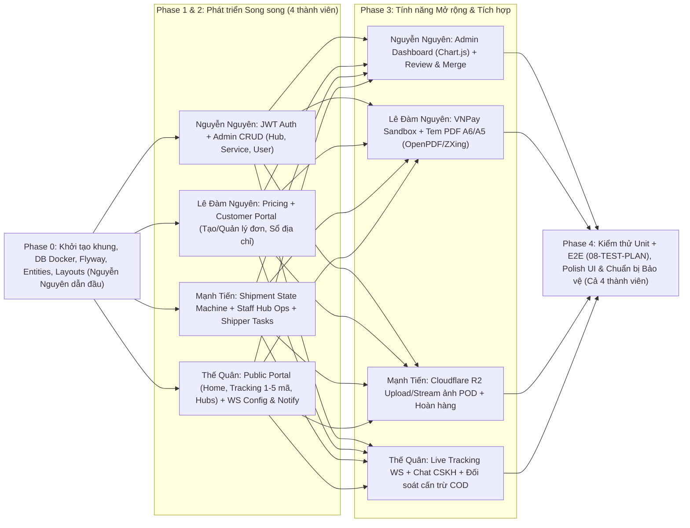

# Kế hoạch Triển khai & Phân công Nhóm (Roadmap)
## Dự án: Hệ thống Quản lý Chuỗi Giao nhận Logistic — UTEExpress

---

## 1. Phân công Vai trò & Phạm vi Sở hữu (4 Thành viên)

Dự án được chia theo **phân hệ dọc (Vertical Slice)** để cả 4 thành viên đều làm đủ *Controller + Service + Thymeleaf*, giảm tối đa xung đột Git và đảm bảo mỗi người đều sở hữu ít nhất một mảng kỹ thuật trọng tâm khi bảo vệ đồ án.

| Thành viên | Vai trò chính | Phân hệ & Kỹ thuật sở hữu | Điểm nhấn khi bảo vệ |
| :--- | :--- | :--- | :--- |
| **Nguyễn Nguyên** | **Nhóm trưởng / Tech Lead** | - Khởi tạo dự án, `docker-compose.yml` (PostgreSQL 16), Flyway (`V1`, `V2`), Entities, Repositories, 2 Layout Thymeleaf dùng chung, Exception Handlers. - **Auth & Security:** Spring Security + JWT (`HttpOnly Cookie` + Bearer), Đăng ký/Đăng nhập/Đăng xuất. - **Admin Portal:** CRUD Chuỗi Hub, Gói dịch vụ, Quản lý Tài khoản & **Dashboard Chart.js**. | Kiến trúc hệ thống, JWT + Thymeleaf stateless, Docker/Flyway, Admin Dashboard |
| **Lê Đàm Nguyên** | **Customer & Payment/PDF** | - **Pricing Engine:** Tính cước + trọng lượng quy đổi `(D×R×C)/5000` + API `/api/v1/public/estimate`. - **Customer Portal:** Tạo đơn 2 cột sticky (GHN), Sổ địa chỉ, Hồ sơ ngân hàng COD, Danh sách/lọc/hủy/chi tiết đơn. - **VNPay Sandbox:** Ký `HMAC-SHA512`, Return URL & IPN idempotent. - **Tem PDF A6/A5:** OpenPDF + ZXing (Barcode Code128, QR Code, Routing Code, font tiếng Việt). | Công thức tính cước, VNPay Sandbox Return/IPN, Xuất PDF QR/Barcode |
| **Mạnh Tiến** | **Logistics Ops & Cloudflare R2** | - **Shipment State Machine:** `ShipmentService` kiểm tra chuyển trạng thái hợp lệ, tự ghi `TrackingLog`, phân quyền phạm vi Hub. - **Staff Portal:** Điều phối Shipper lấy/giao, Nhập kho gửi, Xuất trung chuyển liên tỉnh, Nhập kho nhận, Giao lại / Hoàn hàng (`<= 3 lần`). - **Shipper Portal:** Trang tác vụ 3 tab Bootstrap 5, xác nhận lấy/giao/giao thất bại. - **Cloudflare R2 (POD):** AWS SDK v2 `S3Client`, upload ảnh POD & stream có kiểm tra quyền (`/files/pod/{id}`). | Vòng đời chuỗi đa bưu cục, State Machine, Upload & bảo vệ ảnh POD trên Cloudflare R2 |
| **Thế Quân** | **Public, WebSocket & COD** | - **Public Portal:** Trang chủ, Tra cứu 1–5 vận đơn (che thông tin nhạy cảm), Ước tính cước, Mạng lưới bưu cục. - **Realtime WebSocket (STOMP/SockJS):** `WebSocketConfig`, Live Tracking (`/topic/tracking/{code}`), Thông báo đẩy chuông topbar (`/user/queue/notifications`), Chat CSKH gắn vận đơn (`/app/chat/{id}` + `ChannelInterceptor`). - **Đối soát COD:** Shipper xem COD đang giữ, Staff thu COD từ Shipper, Admin tạo/duyệt phiếu đối soát cấn trừ cước, Customer xem bảng kê COD. | WebSocket STOMP (Tracking, Notify, Chat), Tra cứu đa mã, Dòng tiền & Đối soát COD |

---

## 2. Quy ước Làm việc Nhóm & Tránh Xung đột Git

* **Nhánh chính (`main`):** Luôn ở trạng thái biên dịch và chạy được (`mvn test` pass). Không push trực tiếp lên `main` từ Phase 1 trở đi.
* **Nhánh công việc:** Mỗi thành viên tạo nhánh riêng theo mẫu `feat/<ten>-<chuc-nang>` (VD: `feat/damnguyen-vnpay`, `feat/manhtien-r2-pod`, `feat/thequan-websocket`), hoàn thành thì mở Pull Request để **Nguyễn Nguyên** review và merge.
* **Quy ước Commit ngắn gọn:** `feat: ...`, `fix: ...`, `docs: ...`, `chore: ...`.
* **Quy tắc file dùng chung (chống Merge Conflict):**
  * Các file lõi dùng chung (`pom.xml`, `application.yml`, `V1__init_schema.sql`, `SecurityConfig.java`, `base-portal.html`) do **Nguyễn Nguyên** chốt sớm ở Phase 0–1; nếu thành viên khác cần thêm dependency/route mới thì báo nhóm thống nhất trước khi sửa.
  * Mỗi thành viên chỉ sửa các Controller/Service/Template thuộc gói thư mục của mình (`customer/`, `staff/` + `shipper/`, `public/` + `ws/`, `admin/`).
* **Giao tiếp giữa các Service (Interface gọn nhẹ):**
  * `Thế Quân` cung cấp sẵn `NotificationService` (hàm `sendToUser`, `sendToHubStaff`) và `TrackingRealtimeService` (hàm `broadcastStatusUpdate`) ngay đầu Phase 2 để `Lê Đàm Nguyên` và `Mạnh Tiến` chỉ cần gọi 1 dòng khi tạo đơn / đổi trạng thái.

---

## 3. Sơ đồ Tiến độ & Chạy Song song (Dependency Flow)

---

## 4. Kế hoạch Triển khai Chi tiết theo Phase

### Phase 0 — Khởi tạo Hạ tầng & Khung Dự án *(Mở đường cho cả nhóm)*

| Thành viên | Công việc cụ thể |
| :--- | :--- |
| **Nguyễn Nguyên** | - Tạo `docker-compose.yml` (PostgreSQL 16), `.env.example`, `.gitignore`, `README.md`. - Khởi tạo project Spring Boot 3.4 + Maven (`pom.xml` khai báo đủ thư viện ngay từ đầu để tránh sửa nhiều lần). - Viết `V1__init_schema.sql`, `V2__seed_data.sql` (Flyway) và toàn bộ `enums/`, `entity/`, `repository/`. - Dựng 2 Layout dùng chung (`base-public.html`, `base-portal.html`, `app.css`) và `ApiExceptionHandler` / `WebExceptionHandler`. |
| **Lê Đàm Nguyên** | - Chạy thử Docker PostgreSQL local; đăng ký & kiểm tra thông số **VNPay Sandbox** (`TMN_CODE`, `HASH_SECRET`); chuẩn bị font tiếng Việt (`DejaVuSans.ttf`) cho OpenPDF. |
| **Mạnh Tiến** | - Chạy thử Docker PostgreSQL local; tạo bucket private trên **Cloudflare R2** & lấy `R2_ENDPOINT`, `R2_ACCESS_KEY_ID`, `R2_SECRET_ACCESS_KEY` để test kết nối. |
| **Thế Quân** | - Chạy thử Docker PostgreSQL local; kiểm tra dữ liệu seed và chuẩn bị khung script JS cho SockJS + STOMP (`static/js/`). |

* **Definition of Done (DoD):** Chạy `docker compose up -d && mvn spring-boot:run` thành công trên máy cả 4 thành viên; Flyway tạo đủ 9 bảng + dữ liệu mẫu; trang chủ trống render chuẩn Bootstrap 5.

---

### Phase 1 — Xác thực JWT, Quản trị Danh mục & Nền tảng Công khai

| Thành viên | Công việc cụ thể |
| :--- | :--- |
| **Nguyễn Nguyên** | - Hoàn thiện `JwtTokenProvider`, `JwtAuthenticationFilter` (Cookie + Bearer), `CustomUserDetailsService`, `SecurityConfig`, `AuthController` (`login`, `register`, `logout`, `/api/v1/auth/login`). - Hoàn thiện Admin CRUD cho **Chuỗi Hub** (`/admin/hubs`), **Gói dịch vụ** (`/admin/services`) và **Tài khoản** (`/admin/users` — khóa/mở, gán Hub). - Viết Unit Test `JwtTokenProviderTest`. |
| **Lê Đàm Nguyên** | - Xây dựng `PricingService` (trọng lượng quy đổi `D×R×C / 5000`, làm tròn `0.5 kg`, nội vùng/liên tỉnh, phí COD) và `PricingApiController` (`/api/v1/public/estimate`). - Xây dựng **Sổ địa chỉ** (`/customer/addresses`) và **Hồ sơ + Ngân hàng COD** (`/customer/profile`). - Viết Unit Test `PricingServiceTest`. |
| **Mạnh Tiến** | - Xây dựng khung `ShipmentService` với bảng chuyển trạng thái hợp lệ (`Map<ShipmentStatus, Set<ShipmentStatus>>`), hàm kiểm tra quyền Hub/Shipper và hàm tự động ghi `ShipmentTrackingLog`. - Viết Unit Test `ShipmentStateTransitionTest`. |
| **Thế Quân** | - Xây dựng **Cổng Công khai**: Trang chủ (`/`), Mạng lưới Bưu cục (`/hubs` có lọc theo tỉnh/loại), Trang Ước tính cước (`/estimate` gọi API của Đàm Nguyên) và Trang Tra cứu 1–5 mã vận đơn (`/tracking`, che thông tin nhạy cảm). - Dựng `WebSocketConfig` + `NotificationService` + `NotificationApiController` + `notifications-ws.js` (chuông thông báo trên topbar). |

* **Definition of Done (DoD):** Đăng nhập/đăng xuất được bằng cả 4 tài khoản mẫu; Admin thêm/sửa được Hub & Gói cước; Public tra cứu được vận đơn mẫu & ước tính cước chính xác.

---

### Phase 2 — Nghiệp vụ Vận đơn Cốt lõi & Luồng Chuỗi Đa Bưu cục

| Thành viên | Công việc cụ thể |
| :--- | :--- |
| **Nguyễn Nguyên** | - Review & merge nhánh Phase 1 của 3 thành viên; rà soát đồng bộ phân quyền URL + kiểm tra chống IDOR; hỗ trợ tích hợp giữa các phân hệ. |
| **Lê Đàm Nguyên** | - Xây dựng **Customer Dashboard** (`/customer`), **Form Tạo vận đơn 2 cột sticky** (`/customer/shipments/new` — tự động gọi API tính cước, chọn đồng kiểm, hàng dễ vỡ, định tuyến bưu cục). - Xây dựng **Danh sách đơn** có tab trạng thái + badge đếm + lọc/tìm kiếm/phân trang, **Chi tiết đơn** và **Hủy đơn hợp lệ**. |
| **Mạnh Tiến** | - Xây dựng **Staff Dashboard & Điều phối** (`/staff`, `/staff/shipments`, `/staff/shipments/{id}`): phân công Shipper lấy hàng, xác nhận nhập kho gửi (`IN_ORIGIN_HUB`), xuất trung chuyển liên tỉnh (`IN_TRANSIT`), nhập kho nhận (`IN_DEST_HUB`), phân công Shipper giao, xử lý giao lại (`< 3 lần`) và hoàn hàng (`RETURNING → RETURNED`). - Xây dựng **Shipper Portal** (`/shipper/tasks` 3 tab: Cần lấy / Cần giao / Đã xong) với thao tác lấy hàng & báo giao thất bại. |
| **Thế Quân** | - Tích hợp **Live Tracking WebSocket** (`/topic/tracking/{trackingCode}` + `tracking-ws.js`) vào trang `/tracking` và trang chi tiết đơn; gắn lời gọi bắn thông báo realtime vào các sự kiện tạo đơn & chuyển trạng thái. |

* **Definition of Done (DoD):** Chạy thông suốt 1 đơn liên tỉnh từ Thủ Đức (`HCM-TD01`) → Cầu Giấy (`HN-CG01`) bằng phương thức tiền mặt; trang `/tracking` ở trình duyệt khác tự cập nhật timeline realtime không cần F5.

---

### Phase 3 — Tính năng Mở rộng (VNPay, PDF A6/A5, Cloudflare R2 POD, Chat CSKH, COD & Dashboard)

| Thành viên | Công việc cụ thể |
| :--- | :--- |
| **Nguyễn Nguyên** | - Xây dựng **Admin Dashboard Thống kê** (`/admin` + `DashboardService` + `DashboardApiController` + 3 biểu đồ Chart.js: Doanh thu & sản lượng theo ngày, Tỷ lệ trạng thái, Sản lượng theo Bưu cục, có lọc khoảng ngày). - Hoàn thiện trang lỗi `403.html`, `404.html`, `500.html` và rà soát toàn bộ UI đồng nhất. |
| **Lê Đàm Nguyên** | - Tích hợp **VNPay Sandbox** (`VnPayConfig`, `VnPayService`, `/payment/vnpay-return`, `/api/v1/payment/vnpay-ipn` idempotent, nút *Thanh toán lại* cho đơn `PENDING_PAYMENT` + Unit Test `VnPayServiceTest`). - Xây dựng **Xuất Tem Vận đơn PDF** (`WaybillPdfService` bằng OpenPDF + ZXing, khổ `A6` mặc định & `?size=A5`, Barcode Code128, QR Code, Routing Code, font tiếng Việt) tại `GET /shipments/{id}/waybill`. |
| **Mạnh Tiến** | - Tích hợp **Cloudflare R2** (`R2Config`, `R2StorageService` bằng AWS SDK v2 `S3Client`): bắt buộc upload ảnh POD (`JPG/PNG/WEBP <= 5MB`) trong Modal giao thành công của Shipper. - Xây dựng `FileController` (`GET /files/pod/{shipmentId}`) kiểm tra quyền và stream ảnh từ R2; tích hợp hiển thị thumbnail & modal phóng to ảnh POD trên chi tiết vận đơn. |
| **Thế Quân** | - Xây dựng **Chat CSKH Realtime** (`ChatService`, `ChatWebSocketController`, `ChannelInterceptor` kiểm tra quyền phòng chat, `chat-ws.js`) nhúng vào trang chi tiết vận đơn của Customer và Staff. - Xây dựng trọn luồng **Quản lý & Đối soát COD** (`CodSettlementService`): `/shipper/cod` → `/staff/cod` (thu từ shipper) → `/admin/cod-settlements` (lập phiếu cấn trừ cước & duyệt `SETTLED`) → `/customer/cod` (bảng kê lịch sử). |

* **Definition of Done (DoD):** Đầy đủ 100% tính năng Must-Have & Should-Have trong PRD hoạt động trơn tru trên môi trường local + Docker PostgreSQL + Cloudflare R2 + VNPay Sandbox.

---

### Phase 4 — Kiểm thử Toàn diện, Tinh chỉnh UI & Chuẩn bị Bảo vệ *(Cả 4 thành viên)*

| Thành viên | Công việc cụ thể |
| :--- | :--- |
| **Cả 4 thành viên** | - Chạy toàn bộ bộ **Test Cases (`TC-AUTH` → `TC-COD`)** trong [08-TEST-PLAN.md](./08-TEST-PLAN.md) và xử lý triệt để các bug phát sinh. - Kiểm tra chéo bảo mật chống IDOR (đặc biệt: ảnh POD trên R2, tải PDF, phòng chat WebSocket, phân quyền Staff khác bưu cục). - Hoàn thiện dữ liệu demo đẹp trong `V2__seed_data.sql` và rà soát checklist trước demo. - Chia phần viết Báo cáo đồ án & luyện kịch bản demo trực tiếp (mỗi người thuyết trình & trả lời câu hỏi đúng phần module mình phụ trách). |

* **Definition of Done (DoD):** `mvn test` xanh 100%; hoàn thành toàn bộ Checklist kiểm tra trong `08-TEST-PLAN.md`; sẵn sàng bảo vệ.
